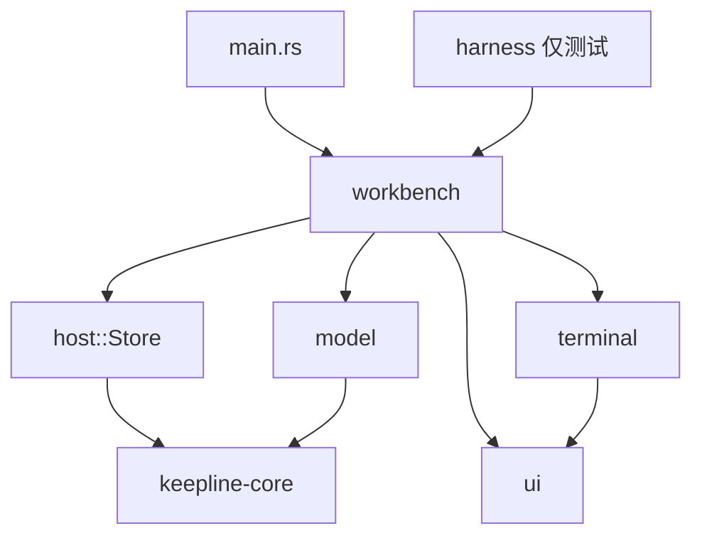

# keepline-app 客户端内部架构

2026-10-26，待评审。范围只包括 `next/crates/keepline-app` 内部的划分。三个 crate 的边界、宿主协议和状态归属仍以 [architecture.md](architecture.md) 为准，本文不改动它们。

## 这份设计要支撑的决定

决定：是否把 `Workbench` 从「一个结构体加十几个 `impl` 文件」改成按功能划分、由编译器强制隔离的结构。

用三个指标判断改完是否值得：

1. **改一个功能只动一个模块。** 例如改搜索面板，只碰 `palette` 模块，不需要去 `mod.rs`、`render.rs`、`sessions.rs` 里找状态。
2. **越界访问由编译器拦住。** 功能状态的字段对其他模块不可见，一个文件读写另一个功能的字段时，编译直接失败。不依靠代码评审或约定。
3. **会话状态判断可以不起 GPUI 就测试。** 分组、提醒、搜索匹配这类纯逻辑单独放在不依赖 GPUI 的模块里。

放弃条件：迁移任意一步后出现以下情况之一，就停在那一步，不再继续拆：

- 为了绕开借用检查，必须大量克隆 `Workspace`，或者引入 `Rc<RefCell<…>>`；
- 一个功能模块的函数普遍需要五个以上来自别的模块的参数，说明拆的边界不对；
- 现有测试或视觉验收出现行为变化，且一步之内修不回来。

## 现状

数字来自 2026-10-26 的代码，已经做完第一步的函数归位。

| 问题 | 证据 |
|---|---|
| 所有状态在一个结构体里 | `Workbench` 有 56 个字段，13 个文件都通过 `use super::*` 加 `impl Workbench` 直接读写 |
| 字段跨文件散落 | `workspace` 被 13 个文件访问，`overview` 被 10 个，`here` 被 6 个 |
| 网络、同步与界面混在一起 | `mod.rs` 里 `request`、`sync`、`apply_workspace` 管着 RPC、忙碌状态、排队和错误，同时直接调用 `sync_panes` 改界面 |
| 纯逻辑被绑在 `&self` 上 | `group`、`sidebar_status`、`needs_attention` 只读 `workspace` 和 `unseen`，却是 `Workbench` 的方法，测试必须构造整个 `Workbench` |
| 测试工具直接改字段 | `visual.rs` 读写 20 多个字段 |
| `main.rs` 混了两件事 | 645 行里，启动和窗口管理大约 300 行，视觉测试框架大约 250 行 |

字段的使用情况已经自然分成了几组。下表是按「哪些文件实际读写它」整理出来的：

| 功能组 | 字段 | 现在访问它的文件 |
|---|---|---|
| 宿主同步 | socket、workspace、busy、slow、busy_seq、syncing、sync_again、queued、error、recognition、_recognition_connection、start_after_save | mod 为主，`workspace` 到处只读 |
| 导航 | space、tab、overview、task_detail、focused、pending_focus、zoomed | 几乎所有文件 |
| 分屏与菜单 | panes、drag、split_bounds、split_target、menu、tab_menu、confirm_close、renaming_tab | layout、render、tabs |
| 搜索面板 | search_open、search、search_index、search_scroll | palette，以及 render、sessions 里的开关 |
| 鸟瞰与清理 | filter_space、changed_only、since、show_stale、show_closed、show_running、show_hidden、card_menu、here、here_more、cleanup、cleanup_index | overview、filters、cleanup、sessions |
| 待办 | form、editing_task、quick_task、todos_open、picking、last_agent、chosen_agent | forms、tasks、sidebar |
| 启动与恢复 | resume、resumed | mod、sessions |
| 提醒追踪 | phases、unseen | mod、sessions |
| 窗口 | away、title_drag | mod、render |

## 目标结构

```
keepline-app/src/
├── main.rs              启动、单实例、窗口创建（只剩这些）
├── harness/             #[cfg(feature = "visual-test")] 视觉测试框架，从 main.rs 和 visual.rs 搬来
├── host/                和 keeplined 通信，不含任何视图
│   ├── connection.rs    现有的识别状态订阅
│   └── store.rs         Store 实体：工作区副本、请求队列、忙碌与错误
├── model/               纯逻辑，不依赖 gpui
│   ├── session_state.rs live_phase、group、提醒判断、session_space、changed_since
│   ├── search.rs        匹配、摘录、排序（从 palette.rs 搬来）
│   └── time.rs          age、ago 等时间文案
├── terminal/            终端组件，不知道 Workbench 的存在
│   ├── pane.rs  screen.rs  keyboard.rs  terminal_input.rs  sprites.rs
├── ui/                  通用组件和主题
│   ├── theme.rs  field.rs  widgets.rs
└── workbench/           功能视图，每个模块拥有自己的状态
    ├── mod.rs           Workbench 外壳：导航状态加各功能的子状态，负责转发
    ├── nav.rs           Nav：space、tab、overview、task_detail、focused、zoomed
    ├── layout.rs        LayoutState：panes、拖拽、分屏、菜单、关闭确认
    ├── tabs.rs          标签名和重命名
    ├── palette.rs       Palette 实体：搜索面板
    ├── overview.rs      OverviewState：筛选、展开开关、卡片菜单、「你在这里」
    ├── cleanup.rs       逐个清理
    ├── tasks.rs forms.rs TaskUi：表单、快速记录、Agent 选择
    ├── sidebar.rs sessions.rs render.rs
```

### 依赖方向



规则：

1. **`model` 不依赖 gpui。** 只吃 `&Workspace` 和普通参数，返回值或枚举。界面用的颜色、文案映射留在 `ui` 或 `workbench`。
2. **`terminal` 不依赖 `workbench`。** 现在 `pane.rs` 只依赖 `desktop`、`field`、`keyboard`、`terminal_input`，已经满足，保持不变。
3. **只有 `host::Store` 做 socket 请求。** 视图要改业务数据，就调用 `store.edit(...)`；收到新工作区后，Store 发出事件，Workbench 订阅这个事件再刷新画面。Store 不调用任何视图方法。
4. **功能状态的字段对模块外私有。** 例如 `OverviewState` 的字段只在 `overview.rs` 里可见，其他模块要用就调方法。这样第 2 个指标由编译器保证。
5. **视图之间不直接互改状态。** 搜索面板选中结果后，发出 `PaletteEvent::Open(hit)`，由 Workbench 外壳决定切换到哪个空间、哪个标签。

### 两种状态容器，按需选择

不是每个功能都做成 GPUI 实体。实体要写订阅和事件，样板代码比较多。

| 用实体（`Entity<T>`） | 用普通子结构体（`Workbench` 的字段） |
|---|---|
| 有自己的异步任务、订阅或输入框，生命周期和 Workbench 不同 | 只是一组开关和选择，跟着 Workbench 渲染 |
| `Store`（RPC 和后台同步）、`Palette`（自带输入框和订阅）、`Pane`（已经是实体） | `Nav`、`LayoutState`、`OverviewState`、`TaskUi` |

子结构体的方法签名形如 `fn toggle_stale(&mut self)` 或 `fn view(&self, w: &Workspace, nav: &Nav, cx) -> impl IntoElement`。按钮回调仍然写 `cx.listener(|this: &mut Workbench, …| this.overview.toggle_stale())`，回调里只碰自己模块的子结构体。

### 不做的事

- 不引入消息总线、命令模式或通用状态管理库。architecture.md 已经明确不要这些。
- 现在不把 `model` 搬进 keepline-core。只有 daemon 也需要同一个判断时再搬，例如宿主要按空间统计会话。
- 不做 trait 抽象来「可替换」视图。

## 迁移步骤

每一步都单独提交，只移动代码、不改行为。每步完成都要满足：`cargo build`（含 `--features visual-test`）通过，`cargo test -p keepline-app` 全部通过，改动前后逐行比对，确认函数体没变；只有可见性、签名里的 `self` 换成参数这类机械改动。

| 步骤 | 内容 | 完成标志 |
|---|---|---|
| 0 | ✅ 函数归位、小组件拆到 `widgets.rs`（2026-10-26 已完成） | — |
| 1 | ✅ 抽出 `model/`（2026-10-26 已完成）：`mod.rs` 的会话状态函数、`Phase`、时间文案搬进 `model/session_state.rs` 和 `model/time.rs`；`group` 改名 `session_group`，和 `sidebar_status`、`needs_attention` 一起改成吃 `&Workspace` 的函数；搜索匹配和列表移动搬进 `model/search.rs`。`Group` 枚举定义搬进 model，颜色和文案的 `impl` 留在 `theme.rs`；两个示例程序因单独引用 `theme.rs`，也加上了 `model`。不依赖夹具的 4 个测试搬进 model，依赖 `fixture()` 的会话状态测试留在 `workbench/tests.rs` | `model/` 里没有 `use gpui` |
| 2 | ✅ 抽出 `host::Store`（2026-10-26 已完成）：socket、忙碌、后台同步、排队和识别状态共 9 个字段搬进 `host/store.rs`，字段对外私有；请求、同步和启动终端的 RPC 都由 Store 发出。最终做成 `Workbench` 的子结构体，不是实体，原因见下方「待决定」第 2 条。`workspace`、`error`、`start_after_save` 仍留在 Workbench：前者是界面读的副本，后两者是界面意图 | `workbench/` 里除了视觉测试框架 `visual.rs`，没有 `rpc(` 调用 |
| 3 | ✅ 搜索面板状态拆出（2026-10-26 已完成）：`search_open`、`search`、`search_index`、`search_scroll` 合成 `palette.rs` 里的 `Search` 子结构体，字段只在 palette 模块内可见；输入框的观察者和订阅也搬进 `Search::new`，注册顺序不变。其他模块只能通过 `is_open()`、`hide()` 访问，视觉测试另有一个仅在 `visual-test` 下编译的 `field()`。和第 2 步同理，没有做成实体，搜索结果的渲染要读工作区和会话状态，做成实体就得把这些都传进去 | `search_*` 字段不在 `Workbench` 上 |
| 4 | ✅ 字段归组（2026-10-26 已完成）：依次引入 `Nav`（nav.rs）、`OverviewState`（overview.rs）、`TaskUi`（tasks.rs）、`LayoutState`（layout.rs），另把两对紧密相关的字段归成 `Attention`（phases、unseen）和 `Resuming`（resume、resumed），都放在 sessions.rs。每组单独完成编译、`visual-test` 编译、测试和逐 token 核对；全部完成后用 visual-20261021 夹具渲染 7 个页面，画面和数据正常。**与计划不同**：子结构体字段是 `pub(super)`，不是模块私有。这些状态被多个功能文件共用，例如「你在这里」卡同时出现在鸟瞰、侧栏和分屏里，设为私有就得为每个字段加读写方法，违背「只挪」。所以第 4 步做到的是「按功能归组」，没有做到「编译器拦截越界」；只有第 2、3 步的 `Store` 和 `Search` 是真正私有的 | `Workbench` 直接字段 12 个（原 56 个），目标 10 个未达到：剩下的 away、title_drag、error 各属不同功能，硬凑成组没有意义 |
| 5 | ✅ 目录整理（2026-10-26 已完成）：`main.rs` 里的视觉测试脚本和 `native_click` 搬到 `src/harness.rs`，只在 `visual-test` 下编译；`hsla` 从 screen 移到 theme；`screen`、`sprites`、`pane`、`keyboard`、`terminal_input` 归入 `terminal/`，`theme`、`field` 和 workbench 的 `widgets` 归入 `ui/`；两个示例程序用别名模块 `mod terminal { pub(crate) use super::screen; }` 适配新路径。**与计划不同**：`workbench/visual.rs` 没有搬，它要读 Workbench 的私有字段，必须留在 workbench 模块里，所以只搬了 main.rs 那一半。`connection.rs` 也留在顶层，因为终端画面也用它。theme 的「组件只用设计令牌」测试按路径扫描源文件，改成新路径，并把搬走的 `ui/widgets.rs` 单独列入，检查范围不变 | `theme.rs` 不引用 `screen` ✅；`main.rs` 358 行，没达到 300 行。搬走 250 行后，rustfmt 又把原来没格式化的启动代码展开了 |

### 迁移后的结论（2026-10-26）

五步都已完成，每步都通过了编译（含 `visual-test`）、43 个测试和逐 token 核对；第 3 到 5 步还用视觉夹具渲染了页面。对照开头的三个指标：

1. **改一个功能只动一个模块**：大体做到。网络同步在 `host/`，纯逻辑在 `model/`，终端画面在 `terminal/`，各功能视图的状态在各自文件的子结构体里。
2. **越界访问由编译器拦住**：部分做到。只有 `Store` 和 `Search` 的字段真正私有；`Nav`、`OverviewState` 等子结构体的字段是 `pub(super)`，因为多个功能共用，硬设私有就要加大量读写方法。
3. **纯逻辑能不起 GPUI 测试**：做到。`model/` 不依赖 gpui，搜索和时间相关的测试已在其中。

决定：采用当前结构，作为后续开发的基线。原计划里的「实体」只在有独立异步任务时才用；子结构体字段私有化留到某个功能真正需要隔离时再做，不为指标单独做。

建议顺序是 1 → 2 → 3 → 4 → 5。第 1 步风险最低，能马上缩小 `mod.rs`；第 2 步把网络和界面分开，后面几步都依赖它；第 4 步改动最大，放在边界都清楚之后再做。

## 风险

- **另一会话并发修改。** 这个目录现在有多个会话在改代码。每一步开始前确认最近没有别人写这些文件；用脚本移动代码，不要手工复制，移动后逐行比对。
- **借用冲突。** 子结构体的方法同时需要 `&mut self.overview` 和 `&self.store.read(cx).workspace` 时，可能和 `cx` 的借用冲突。处理方式：先取出需要的只读数据，再调用可变方法。如果这种情况普遍出现，就触发放弃条件。
- **视觉验收覆盖不全。** 单元测试只有 43 个，很多交互只靠视觉框架和手测。第 2、3、4 步完成后都要跑一次视觉验收，不能只看编译通过。

## 待决定

1. 第 4 步之后，`Workbench` 外壳的直接字段上限定为 10 个是否合适。
2. ~~`Store` 是做成实体，还是做成普通子结构体。~~ 已决定（2026-10-26）：做成子结构体。实施时发现，做成实体后回复要通过事件转交 Workbench，事件在 Store 的更新结束后才送达，处理顺序会变：「保存并开始」的启动请求可能被排队中的编辑抢先，因为 Store 正忙，启动请求就被丢弃了。子结构体让 RPC 回调仍在 Workbench 里按原顺序执行，同时字段私有，网络状态照样只有 `host/store.rs` 能改。
