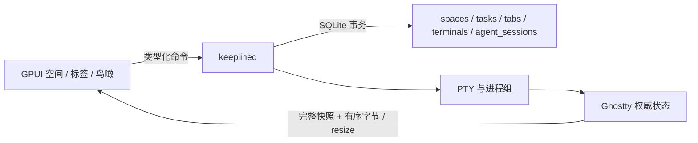

# 工作台实现架构

2026-10-20。决定：采用单 Rust 宿主与 GPUI 客户端。本文件是实现契约；
product.md 保留用户行为，tech.md 的旧 Tauri/Bun 协议不再作为实现依据。
目标是让 40 个会话不随窗口关闭而丢失，重新连接能继续输入，业务归属不受分屏布局影响。
输入法、恢复一致性或资源预算不通过时停止扩展 UI，先修复对应边界。

## 状态归属

**keeplined 是 Terminal 与 AgentSession 的唯一写入者；Terminal 拥有 PTY，Tab 的分割树拥有摆放位置，AgentSession 拥有 CLI 对话身份、待办归属与结局。客户端只拥有显示副本、焦点和输入法组合态。**

按 product.md 4.3，两个对象不能合并：

| 对象 | 权威字段与关系 | 不得推导 |
|---|---|---|
| Terminal | argv、cwd、pid、进程状态、原始空间；一个 PTY 可先后承载多个 AgentSession | shell 存在不代表 Agent 对话存在；退出不代表验收完成 |
| AgentSession | runtime + CLI session ID 唯一身份、terminal、task、outcome、updated、日志来源 | 标签或终端移动不能改变待办或结局 |
| Tab | 空间、标题、关闭状态、default_task、layout 分割树；叶节点只引用 Terminal ID | default_task 仅用于第一次识别新对话，不拥有已有对话 |
| Task | 空间、说明、逐条 acceptance；每条有稳定 ID、说明与可为空的证据引用 | 没有证据不等于已验证失败；有证据也不等于用户已验收 |
| Content / session_records | 宿主增量解析；标题、用户原话、助手文本、工具调用/回执、来源位置、末轮与活动时间；按 AgentSession 投影 | Agent 自述不是机械成果，日志存在不表示进程在线；派生分组不能替代用户结局 |

`Tab.layout` 是摆放的唯一事实源，不在 Terminal 重复保存 tab/position。
分支保存 Right / Down、万分比 ratio 与两个子树；关闭叶节点折叠父节点，将全部面积归还兄弟子树。
不限叶节点数量；单叶无分屏边框；放大是客户端临时视图，原树与比例不变。
`Workspace.tab_terminals()` 提供标签的终端引用。关闭标签保留位置；跨空间摆放只改位置。
`AgentSession.current` 表示最近一次已证实且尚未结束的对话关联，不代表正在工作或已完成。
SessionEnd、已证明的 Agent PID 的 kqueue NOTE_EXIT、宿主失联和下一次对话关联会结束该关联；
退出事件只修改 current，不改任务、结局，也不关闭仍活着的 shell。旧对话保留 terminal 作为历史来源。
`RecognitionStatus.terminal_hints`、workspace_revision 是宿主的临时识别/同步状态，走现有推送协议；
Theme、焦点、临时放大、菜单、拖拽预览和视图选择属于客户端，不写入业务对象。
拖拽结束用一次 PutTab 持久化树与比例；客户端只为当前标签的可见叶节点创建 Pane / 订阅，放大后仅保留一个。

三个 crate 足够：

| 边界 | 归属 / 禁止依赖 | 验证 |
|---|---|---|
| keepline-core | Terminal / AgentSession、逐条验收、wire 数据与 Ghostty 封装；不依赖 GPUI、数据库或进程生成 | 同 PTY 多对话、跨空间移动、独立结局、快照恢复测试 |
| keeplined | 运行时、PTY、分表 SQLite、进程与日志识别、Unix socket；不依赖 GPUI | 真实 PTY + 模拟 CLI + Hook + JSONL + 数据库重启集成测试 |
| keepline-app | GPUI、显示副本、输入法；不能写数据库或直接生成 Agent | 编译检查、输入法组合态测试、原生交互验收 |

core 内直接使用具体 Ghostty 类型，不为未选择的引擎引入 trait。
daemon 保留一个全局业务状态锁，每个终端有独立状态锁。PTY 读阻塞于内核，
输出只唤醒订阅者；客户端队列有界，慢客户端断开并通过新快照恢复。
不轮询全部会话，不引入消息总线、插件注册表、事件溯源或旧协议兼容。

## 四个关键契约

1. **生命周期**：启动意图先持久化，再创建 PTY，最后发布进程身份。重复 ID 返回原终端；
   不重放结果未知的启动。后台重启后旧记录成为 interrupted，不能假装原 PTY 仍可写。
   客户端 disconnect 只释放控制权；stop 才发送进程组信号。主进程 wait 与 PTY 排空分别记录。
2. **恢复**：订阅注册和二进制快照在同一终端锁内完成。快照分块，结束标记后才能输入；
   后续 output / resize 有序。使用 Ghostty snapshot API，不使用文本或 VT formatter 代替完整状态。
3. **写入**：每个终端只有一个连接可写，其他连接只读；明确接管替换 owner。没有活着的 owner 时自动赋权，断开事件可将已连接的只读客户端提升为 owner。
   Attach 时用订阅 socket 的非阻塞 peek 排除尚未清理的断线；WRITABLE 帧推送变化，无心跳或周期轮询。
   input 与 resize 检查同一个 owner。输入应答丢失不得自动重发。
   仅后台响应终端查询；显示副本不向 PTY 回答。
4. **业务**：空间→待办→AgentSession 与 空间→标签→Terminal 分别存储。
   关闭标签不调用 stop；进程退出不等于用户验收。
   SQLite 是业务事实源，记录 Agent 自述和机械证据时必须区分来源。

## SQLite 与识别边界

五张对象表：`spaces`、`tasks`、`tabs`、`terminals`、`agent_sessions`。
`task_criteria` 按条保存验收标准与证据引用，`meta` 保存并发 revision。
`tab_layout_nodes` 规范化保存树节点（tab_id、二进制子路径、terminal_id 或 axis/ratio）；
终端引用有唯一约束，跨标签移动和树更新处于同一事务，不用 JSON 保存布局。
不再存在 `workspace.body`。argv 作为有序参数数组保存在 Terminal 的一列中，
不把业务对象或整个工作区装进 JSON。变更只 upsert 有变化的对象，并在同一事务内更新位置、
当前关联和 revision；SQLite 外键与唯一索引约束对象关系。
旧实验 JSON 库及旧 tab/position 固定网格库明确拒绝打开，使用新的隔离目录，不自动迁移、回填或删除。

P1 的身份识别有两条可验证路径：

- **日志 + 进程打开文件**：读取 `~/.codex/sessions`、`~/.claude/projects` 的身份头，
  用进程父子关系定位托管 PTY，再以该 Agent 实际打开的唯一日志文件确定 CLI session ID。
- **Hook + 进程 + 日志**：Hook helper 从 stdin 接收原 CLI 的 session_id / transcript_path，
  后台核对发送进程的祖先链、Agent runtime 与日志身份。三者一致才关联。

只有同目录、只有日志、多个候选或 ID 不一致都不能建立托管关联。
未关联日志进入 `log_files` 身份索引；内容层阶段将默认最近 7 天的身份作为只读外部 AgentSession 注入 Workspace（无 terminal/current），超期在快照/事件时过滤；
证明托管关联后创建 AgentSession，已有 AgentSession 接收增量更新时间。普通 shell 只产生 Terminal。同一个 CLI 身份已在另一终端
关联时，拒绝第二个当前关联；明确结束原关联后 resume 保留同一 AgentSession。

本轮提供 `keeplined scan --runtime DIR` 与
`keeplined hook --runtime DIR --agent codex|claude` 的实际入口。
Hook 处理身份关联，并接收可选的 PermissionRequest / Stop 等回合事件，不安装或修改用户配置。缺少 transcript_path 时查询 SQLite，
不会临时遍历日志目录；显式路径也通过同一个持久化游标读取。

### 自动订阅的资源边界（产品卡 3.1）

采用 **一次后台身份索引 + FSEvents 发现 + 托管日志 kqueue 通知 + 持久化增量游标**，无定时器、无轮询后备。
本机 5500+ 文件、约 17 GB 的历史正文不作为启动时必须读完的数据。

- **进程边界**：从处于 Running 的托管 PTY PID 开始，用 `proc_listchildpids` 遍历其后代，
  `ps -p` 只读取这些 PID 的命令；`lsof -p` 只接收已证明属于托管终端的 Agent PID。
  不使用全系统 `ps -ax` 或全 Agent `lsof`。普通空闲没有进程探测。
  已关联路径追加只更新该文件游标和现有会话时间，不再查询整个索引或执行 ps/lsof。
  新的未关联身份首次出现、托管终端集合变化或已发现的 Agent 仍未关联时，才在未关联日志事件上探测。
  已尝试但不属于托管终端的外部日志不随每次追加反复探测；Hook 和手动刷新是显式识别入口。
- **首次启动**：服务 socket 就绪后，后台消费 SQLite `log_scan_dirs` 目录工作表。
  完成的目录即从工作表删除；崩溃只允许重做尚未完成的目录，不从根重来。
  每个历史文件最多读取 256 KiB 身份前缀与 EOF 边界一字节，找到身份提前结束，
  P1 当时将旧正文的 EOF 记为基线；本阶段对近期文件新增有界尾段导入，历史库仅对缺少内容投影的缓存身份补一次，不重扫目录。
- **文件事件**：先启动原生 FSEvents FileEvents 再索引，避免扫描窗口漏事件。
  尚不存在的 CLI 日志目录监听其最近存在的祖先，但回调过滤掉所有旁支路径，
  避免自身 SQLite 写入触发循环。有界队列按批处理并去重路径，线程阻塞等待事件。
  FSEvents 在写句柄长期打开时可能延后追加通知，因此只给**当前已关联日志**注册 kqueue vnode 写入、
  替换和删除通知；不是给 5500 个历史文件开描述符。先注册再读增量关闭竞态窗口。
  Hook 唤醒同一事件队列，终端退出后撤销对应 vnode 监听；两条事件源均无定时轮询。
- **增量读取**：`log_files` 持有 runtime、路径、device/inode、offset、有限的未完成行、CLI ID 与更新时间。
  只读 `[offset, 已捕获文件长度)`；半行跨重启保存，单行超过 256 KiB 后丢弃该行至换行。
  inode 替换或文件缩短重建游标；删除移除索引但不删除已有 AgentSession 的业务归属和结局。
  Hook 与监听器串行更新游标，避免同一文件出现两份相互覆盖的进度。
- **重启续接**：`log_index` 保存已处理的 FSEvents event ID；先持久化文件游标与关联，
  再更新事件编号。正常重启直接重放期间的文件事件，不重新扫描目录或遍历所有日志文件。
- **事件缺口**：MustScanSubDirs / 丢事件按事件路径补扫该子树；队列溢出保存丢失事件所属目录，
  合并嵌套范围。范围记录最多 64 个，超限只扩大到相应 CLI 日志根；编号回绕无法确定更小范围时，
  修复配置的日志根，不扫描 HOME 或整个文件系统。此为异常触发，不是周期性全量扫描。
  补扫只读取旧文件身份前缀与新增字节，复用游标；每步最多 128 个目录项，20 ms 后在当前文件操作
  结束时让出执行机会。未完成范围先写 SQLite；重启继续该范围。缺口内消失的索引路径会清理，
  不删除 AgentSession 的业务数据。
- **恢复与状态**：根移动/队列溢出时先重建监听，保留未处理事件的重放起点，再补扫；不直接退出线程。
  文件系统错误保留未完成范围并等待下一次真实事件重试，不忙重试。
  `WatchRecognition` 主动推送 `Interrupted → Recovering → Healthy`，GPUI 现有提示区显示
  “识别中断，正在补扫”；目录尚未重建时显示等待状态，状态连接断开也显示中断。
  `RecognitionStatus` 提供读回与机械计数；没有状态轮询定时器。
  FSEvents 历史不是无条件完整保证；异常依据见 [Apple FSEvents 文档](https://developer.apple.com/library/archive/documentation/Darwin/Conceptual/FSEvents_ProgGuide/UsingtheFSEventsFramework/UsingtheFSEventsFramework.html)。

索引历史只保留身份元数据，避免 5500 条外部历史填满实时 Workspace 的 1 MiB 控制帧。
P1 当时不包含历史浏览或回合内容存储；P2 内容层已实现，见本文末尾 2026-10-21 记录。
真实安装 CLI 的 Hook 配置与完整交互仍须单独验收。

## 依赖与参考

| 来源 | 采用 | 不复制 |
|---|---|---|
| 现有 next/keeplined | PTY、同 UID、连接控制权、启动意图原则 | major 0 文本镜像、定时 pull、截断 Unicode |
| terminal-eval kl-relay | 快照与订阅同锁、后台独立存活 | 无限制客户端队列、忽略错误、无回执写入 |
| terminal-eval kl-gpui | 单元格绘制、按输出唤醒、空闲补丁 | 测评浮窗、定时统计、多引擎开关 |
| libghostty-rs | 锁定 0ef80413de1326685743378efbfa06d849e041a7 | 跟随分支或自行重写 VT parser |
| Zed GPUI | 锁定 2a857f5f2ec368745c1af5209d49836968fe75b8 | 编辑器全套 workspace/插件架构 |

依赖由 next/bootstrap.sh 准备到被忽略的 .deps；提交中保存版本与补丁。
本机可使用已测评的同版本 checkout，交付必须验证 bootstrap 路径。
旧 TS 产品继续由原入口运行，不接入新后台；新产品使用独立显式数据目录，
不迁移、不覆盖用户旧库。当前 wire major 为 2（分割树与控制权推送），不提供旧协议兼容桥；本轮不替换用户正在运行的 major 1 宿主或数据目录。

## 实施与验收

| 阶段 | 交付 | 验证命令 / 门槛 |
|---|---|---|
| P0 | 拆分 Terminal / AgentSession；逐条验收；分表 SQLite；真实快照与独立宿主 | `cargo test -p keepline-core -p keeplined`；不得从 PTY 退出推导对话结局 |
| P1，先完成身份验证 | 进程识别 + Hook + 两家 CLI 日志读取；一个 PTY 先后关联多条对话；外部日志不冒充托管；跨空间摆放不改变归属 | `two_cli_conversations_in_one_real_pty_keep_separate_ownership_after_restart`、`log_identity_alone_does_not_bind_by_directory_and_ambiguity_stays_unbound`；FSEvents/vnode 自动关联、40 空闲会话、4 Agent 30 秒负载和缺口恢复状态测试；再验收真实 CLI |
| P1，分屏与原生终端 | 任意嵌套分割树、比例持久化、放大还原、同一画面菜单；无活跃 owner 自动赋权；进程内符号字体回退 | 见 [本轮逐项证据](evidence/split-tree-20261020/README.md)：原生单画面/四分屏/菜单截图、布局与控制权测试、8 可见画面 CPU/内存；候选窗及两画面真实拼音由用户手测 |
| P2，会话内容层 | 已实现确定性解析、原话/机械证据落库、四字段卡/分组、近期外部会话、继续/存为待办、状态栏与鸟瞰 | [20 会话逐字段抽查、原生截图与资源](evidence/content-layer-20261021/README.md)；抽查由实现代理核对，不是用户人工签收；真实安装 Hook 与长期功耗仍未验证 |
| P2，后续验收 | 通知点击、完整真实 CLI 生命周期、长时间预算 | 未完成，不因内容层的局部验收勾选整阶段 |

每阶段只在验证后更新 tasks.md。编译成功不能证明 IME、通知、功耗或完整 CLI 体验。
本次无推送、合并、发布、安装替换或用户 Hook 修改授权；本地实现与隔离测试直接执行。

## 本轮模型修正验收

2026-10-20，本地 `feat/agent-workbench`，未提交、未推送：

- `cargo test -p keepline-core -p keeplined`：14 项通过。
- `cargo clippy -p keepline-core -p keeplined --all-targets -- -D warnings`：通过。
- `cargo check -p keepline-app`：通过；界面仅适配新模型。GPUI 上游仍有弃用警告。
- 端到端用例通过真实 PTY 先后运行名为 codex / claude 的隔离模拟进程，
  实际执行 Hook helper、核对 JSONL 身份、拒绝不匹配 ID，再读回分表 SQLite 并重启后台。
  证明对象拆分与关联链路，不声称完成官方 CLI、输入法或自动监听验收。

决定：采用此次模型拆分；继续 P1 的识别与生命周期验证，界面扩展继续后置。

## 自动订阅资源验收（复验修订）

前轮“17 项全过”只代表当时一次运行，不能证明空闲断言稳定；用户复验和本轮并行运行均出现
CPU/磁盘为零但 Unix syscall 增加 2 的失败。本轮不再沿用严格等于零的全局 syscall 断言。
完整命令、诊断边界、预算和本轮结果见 [复验记录](evidence/resource-recheck-20261020.md)。

- [x] `forty_idle_terminals_have_no_periodic_background_io`：40 个真实 PTY 中的模拟 Codex 自动关联；
  外部 Agent 不进入托管 PID / lsof 集合。5 秒 CPU <0.5%、磁盘读写增量为零；
  整体 Unix syscall 容差 0–4，但后台日志读取、目录遍历、索引写入、ps/lsof 计数必须严格不增长。
- [x] `four_agents_write_for_thirty_seconds_without_repeated_process_probes`：4 个 Agent，约每秒 10 行，
  持续 30 秒；两条日志始终保持写描述符打开，另外两条逐行开关。暖机后 ps/lsof 启动增量必须为 0，
  后台累计 CPU <0.6 秒（单核平均约 2%），新增读取 >80 KB，逐文件核对 offset 等于实际 EOF。
- [x] `overflow_keeps_only_affected_subtree_and_does_not_latch`：队列溢出保留具体子树，恢复后继续收事件。
- [x] `must_scan_repairs_only_event_subtree_and_publishes_status_then_continues`：仅扫描事件子目录，
  不读旁支；验证实际序列化的中断、补扫、正常状态和恢复后的增量处理。
- [x] `recognition_status_stream_recovers_after_log_root_is_rebuilt`：真实 FSEvents WatchRoot、Unix socket
  状态流、目录移动与重建、旧路径索引清理；同一后台不重启即可继续消费日志。
- [x] `initial_index_skips_large_bodies_and_never_rewalks_completed_directories`：17 GiB 稀疏历史文件
  跳过正文；正常重开数据库不遍历目录、不打开日志正文。
- [x] `cursors_survive_restart_partial_lines_truncation_and_inode_replacement`：半行续接、重复事件、截断、
  inode 替换和删除。
- [x] `fsevents_delivers_new_files_and_replays_changes_after_restart`：实际原生文件事件及停机事件重放。
- [ ] 真实安装的 Codex/Claude 完整身份与 Hook 生命周期、原生提示人工验收、长时间整机功耗仍待验证。

决定：采用已关联文件快速路径、事件范围补扫与推送状态；否定每次追加都探测进程和错误永久闩锁。
继续 P1 真实 CLI 验证；本轮仅增加故障提示，不恢复其他界面功能扩展。

## 2026-10-20：现有界面按设计稿重做

决定：采用 `design/README.md` 与 Main / Overview 的布局、颜色、字体、尺寸；此前“继续暂停界面”的门槛由用户本轮明确恢复视觉重做的指令更新。实现只重做现有功能。详见 [逐项验收与并排图片](evidence/visual-20261020/README.md)。

- `Theme` 是 UI token 的唯一来源；默认终端底色/前景也使用 Theme，CLI 的 ANSI/OSC 颜色保留。字体选择只解析一次，不随每帧枚举字体。
- 主视图对齐顶栏、左栏、标签、待办条、画面（当时为固定网格，本轮已替换为分割树）、底栏；鸟瞰对齐待办行和分组卡片。只订阅可见终端，空闲无重绘计时器。
- Codex 预填暂用 `--no-daemon`，续接命令同样携带；用户原始输入不重写。未关联命令提交后有一次 500ms 启动宽限识别，识别到托管 Codex 后才显示指定提示；不是定时 ps/lsof。已关联日志只增量读取。退出监听使用单个阻塞式 kqueue，不对每个 Agent 建立轮询线程。
- 修订推送只携带状态与版本；客户端收到新版本后读取工作区，处理请求期间漏过的更新也会补取。没有新增后台轮询。
- 对照图片使用真实 GPUI 原生渲染导出、隔离模拟 CLI 和真实 PTY，逻辑尺寸 1440×900。不是用户正式会话或真实 Agent 调用。原生应用的最终人工体验和输入法仍待手测。

仍未对齐：全局会话搜索、设置、拖动侧栏、智能“你在这里”卡、任务详情/完成、过滤/新标记/清理等此前未实现的功能；会话卡保留显式结局按钮。本轮已取消空位，并完成画面滚动内容搜索及待办菜单中的 Agent 选择。等待/待核对分类没有证据时不伪造设计稿示例。以上均在证据表单列，不能据本轮截图宣称 M2 全部完成。

## 2026-10-20：中文输入法手测后的三项修复

决定：组字属于客户端绘制状态；Terminal 光标坐标与其可见性分离。实际字体度量统一供终端绘制、resize、组字覆盖层及 UTF-16 范围定位使用；未知光标沿用最近已知位置，不回退 (0,0)。组字不写 PTY，提交时才走原 Input 路径。

Interrupted 是已结束进程的持久状态，客户端不得尝试 attach。显示明确中断占位；原位重开创建新 Terminal 并替换摆放，关闭只移除摆放；历史 AgentSession、待办归属与结局保留。宽字符按 Ghostty 的回退字形适配/居中思路，使用两格宽度及真实 shaping 度量绘制。

本轮 6 项应用单元测试、1 项真实 PTY 重启回归及原生字体/组字渲染检查的记录见 [逐项证据](evidence/ime-fixes-20261020/README.md)。用户已确认上一构建的选字、回车上屏字母、退格正常；新构建的系统拼音候选窗位置与交互仍待人工复测。P1/M2 阶段不因这些局部修复自动标记整体验收通过。

## 分割树与终端修复（2026-10-20）

决定：采用 Tab 分割树，取消固定网格、空位与数量上限。布局事务不修改 AgentSession 的待办和结局。
向右/向下拆分启动空 shell；动作触发时用 proc_pidinfo 读取源托管 shell 的当前目录，包含 cd 后的变化，失败明确报错。
画面菜单与状态栏 ⋯ 共用同一组动作。中断发送 Ctrl-C；停止 Agent 只向再次核对 runtime 与祖先链的 Agent PID 发 SIGTERM。
关闭画面仅移除树叶，不停止 PTY。搜索仅在用户提交时读取有界 VT 滚动内容，复制选区/可见内容，粘贴走原输入队列。

终端字体以原等宽字体测量单元格，CoreText 进程级注册内嵌 Symbols Nerd Font Mono v3.4.0（MIT）。
纯符号字体不含 m，不能用 GPUI 的主字体加载路径；通过 CoreText cascade 回退。不会安装或更改系统字体。
CJK 与私用区符号按 Ghostty 给定列宽缩放并居中；原生几何检查核对非零 glyph 与单元格边界。

本轮截图和性能使用隔离 fixture、真实 PTY 与原生 GPUI renderer；没有启动真实 Agent，没有重启用户后台。
详见 [逐项验收与资源数据](evidence/split-tree-20261020/README.md)。原系统拼音候选窗位置、两画面真实拼音继续保留人工待确认，不用渲染测试冒充通过。

本轮另纠正资源计量：本机 `proc_pid_rusage` CPU 字段须按 `mach_timebase_info` 将 ticks 转为纳秒。
此前直接除以 1e9 的 CPU 结论撤回。修正后负载测试一度超 0.6 秒预算；复用热点 SQL、跳过不变检查点并合并已排队通知后，同预算复测通过（0.5358 秒）。无定时等待、无放宽断言，详见 [计量纠正](evidence/split-tree-20261020/cpu-units-correction.md)。

## 2026-10-20 键盘与客户端生命周期修复

采用：键盘输入在 `keyboard.rs` 映射为 Ghostty 物理 Key，同时提供原始字符、未按 Shift 的码点和修饰键。Ctrl/Alt 交由 Ghostty 按当前 VT 模式编码；macOS Option 按 Alt 处理，保留终端 DEC 模式及 Kitty 协商。普通文字继续走 IME 提交路径，marked text 不写入 PTY。未额外实现一套控制字符编码器。Ctrl-[ 保留 Ghostty 的 fixterms CSI-u 行为。

客户端寿命与窗口寿命分开：可见的「退出 Keepline」菜单及 ⌘Q 退出客户端；最后一个窗口关闭不退出进程。GPUI `on_reopen` 和重复启动唤醒共用恢复入口，有窗口则激活，无窗口则读取当前 Workspace 并重新 attach。退出/关窗仅释放客户端连接，不发送 Stop。

同一用户的新客户端通过 `~/.local/share/keepline-client/client.lock` 的系统 flock 保持单实例（不按 runtime 分裂实例）。第二个进程仅连接 `client.sock` 唤醒主实例后退出。通知使用阻塞 accept 和异步消息，无周期轮询；异常退出由系统释放锁，下次启动清理失效 socket。不为此前没有实例锁的旧二进制增加兼容机制。

连接已有宿主时先检查协议。major 1 只做版本探测，不访问其 Workspace 或启动替代宿主；显示「后台版本过旧，需要重启后台（会中断正在运行的终端）」。提示明确说明不迁移的旧空间、待办、标签布局、终端记录、Agent 会话归属与结局，以及原始 CLI 日志不会删除。旧库保持原样，切换到新库需要用户自行处理运行终端、备份与切换，本客户端不执行重启或删除。

验收与边界见 [键盘和生命周期证据](evidence/keyboard-lifecycle-20261020/README.md)。豆包候选窗和两画面拼音已由用户在 21:55 手测通过，来源单独记入 [IME 记录](evidence/ime-retest-20261020/README.md)。

## 会话内容层：决定与验收合同（2026-10-20，实施前）

本阶段要支撑的决定：用户离开后回来，能否仅看会话卡判断自己要了什么、哪些动作有结果、现在停在哪里，以及下一步该核对什么。采用 Rust 的确定性日志解析，不调用模型；移植旧 TS 的记录识别、工具结果关联与证据限制，不复制旧账本架构。

最小实现：在 core 增加内容投影与分组，在后台增加解析器和按会话/记录持久化，复用现有文件游标、FSEvents、SQLite 和 Workspace 通知；不引入服务、任务队列或第二套扫描器。身份关联与内容解析分开：未绑定的近期日志也能形成外部卡，但不因此获得终端控制权。

状态归属：原话、助手文本、工具调用/结果及来源由内容层记录；标题、最后回合、活动时间和四字段卡由这些记录派生；结局/待办归属仍属于 AgentSession，终端状态属于 Terminal。用户原话包含追加要求，系统注入/工具结果不混入。工具调用只能证明尝试，成功结果才是「做成了」；命令输出中的测试和提交必须与实际执行命令匹配，读取旧日志、echo 示例和助手自述不能充当证据。Recap/Next 只能进入「停在」「下一步·推断」。未知退出码、孤立结果、截断记录明确保留未知。

读取与内存指标：首次只读身份头（最多 16 KiB）与近期文件末尾段（最多 128 KiB），跳过不完整首行；以后沿用路径/dev/inode/offset，只处理追加完整行。原始事件及工具关联在 SQLite 中按记录保存，客户端只取有界卡片投影；卡片标明历史覆盖范围。首次索引在后台，目录工作单和游标/派生内容原子提交；重启不重扫全文。外部窗口默认 7 天，可通过后台参数指定 N；旧外部会话在读快照/事件时过滤，不启动清理轮询。

分组遵守 product.md 第 5 节：用户结局优先；未闭环且非运行回合超过 3 天先归「很久没动」（暂存到期从到期时刻计算）；其余依次是明确输入请求、最后回合错误/丢失、回合结束并有完成声明、停止/空闲未完成、运行中。回合开始可重新打开旧结局；进程退出不是完成证据。时间边界通过用户刷新或文件事件求值，不定时访问日志。

验收逐项记录证据：Codex/Claude 各类消息和 Hook 的合成回归；增量跨半行/重启/轮转去重；正文追加不得增加 ps/lsof；离线只读本机至少 20 个真实会话，逐个对照源偏移抽查「你要它/做成了/停在/下一步·推断」，四列分别计准确率，未知明确显示不能算错误补全；目标「做成了」无自述误报，其他字段至少 90% 有源或明确未知。测量全索引耗时、目录数、实际读取字节；40 外部 + 8 托管空闲 30 秒，后台业务 I/O 及进程探测增量为 0，客户端+后台平均 CPU <0.5%、物理内存 <300 MiB（同机 Ghostty 相对预算另记，不冒充已通过）。产出真实原生鸟瞰与锚定卡片截图。

放弃条件：无法证实工具执行结果时放弃成功结论，展示未知；尾段缺失原始要求时放弃猜测，显示历史未覆盖；未知日志结构记录未解析计数；若需要扫描全量正文、周期轮询、改用户 CLI 配置或调用模型才能生成卡片，放弃该路径；资源超预算或抽查出现自述当证据，先修复，不宣布验收通过。真实日志只读，用户正在运行的 major 1 后台不重启；在隔离 runtime 验收。阶段提交依次为合同、内容解析/落库、界面和外部入口、实测证据，不推送。

## 会话内容层：实现决定与实测（2026-10-21）

采用上述最小设计：core Content 为有界显示投影；daemon content.rs 负责确定性分类与调用结果关联；SQLite `session_records` 按 path/inode/offset/ordinal 去重，存原话、助手文本、调用/结果及来源；`session_content` 按日志保存有界派生投影和未完成调用关联。全工作区仍按对象分表，不引入整体 JSON 快照。新内容可与缓存游标同事务更新；中途失败回滚，不留下已前进游标却缺内容的状态。

客户端只有 Workspace 显示副本。后台持有所有分组依据和用户结局；卡片原话保留首条与近期追加，完整已读取原话仍在记录表。存为待办从后台记录构造说明，与 AgentSession 关联同次提交；尾段不覆盖的历史明确标注。绘制/传输只用有界投影，不把所有会话正文塞到 GPUI。外部会话无终端控制权；继续动作启动 shell、预填恢复命令，回车才运行 CLI。Codex 续接携带 --no-daemon，Claude 使用 --resume。

采用一次事件触发的 200ms 突发收集窗口合并 vnode/FSEvents 通知与 SQLite 事务，最多 64 批、截止时间不延长；没有事件时无限阻塞等待。该决定更新此前“无定时等待”的表述：**没有周期定时器，但活跃事件批次有一次有界延迟**。原 FULL 持久化不降级。已关联文件只推进内容游标，不额外查 ps/lsof。未关联进程仍按既有边界识别；外部索引不启动全系统进程扫描。

wire major 3 明确断开旧协议；一次只读探测区分 major 1/2。major 1 不迁移旧对象库，major 2 保留同结构空间/待办/结局并增加内容表。任何宿主重启都会中断旧 PTY，客户端给出提示，不执行重启。当前用户后台保持原状；本轮验收使用独立 HOME/runtime。

实测：首次 5,578 文件 / 1,605 目录读 146.34 MiB、8.171 秒；同库再次启动读量与目录遍历为 0。40 外部卡片 + 8 可见模拟 Agent PTY 空闲 30 秒，客户端+后台 CPU 0.0781%、footprint 85.033 MiB，业务 I/O 和进程探测增量 0。4 模拟 Agent 连续写 30 秒 CPU 0.2723 秒，ps/lsof 增量 0。预算通过，不代表长时功耗或真实 Agent 自身资源消耗通过。

真实日志抽查 20 会话（3 Codex、17 Claude）：四字段各 20/20 有源或明确未知/推断，助手自述误记成果 0；已知原话 17/20，机械成功证据 5/20，末轮已知 16/20。**实现代理逐条核对，未获用户人工签收**。未知复合命令/编排工具结果不猜测，成果召回仍有缺口。首次抽查发现并修复转述注入与代码围栏完成声明误判；原生验收发现并修复外部继续的异步 Pane 创建崩溃。

本阶段采用结论与完整逐项边界见 [内容层证据](evidence/content-layer-20261021/README.md)。原生图已对齐鸟瞰分组、画面内锚定白色卡与状态栏；长标题及长文本截断/滚动，不以占位样例填空。全局搜索、通知、安装版 Hook 生命周期、默认守护模式关联、Dock 重开及长期功耗不随本次完成。并行终端渲染对照工作不属于本阶段提交。

## 鸟瞰降噪：实施前决定（2026-10-21）

采用最小修正：内容投影增加交互来源判定及可读隐藏原因，复用现有卡片与增量解析；不删除日志、不影响托管控制权。仅有交互入口证据且没有自动化/子代理/临时目录证据的会话进入默认鸟瞰和“需要你”；未知来源也默认隐藏，展开说明未知，不假称确定为自动化。明确的 unattended 后台任务标记可否决继承的桌面入口，不能仅按插件名字过滤。标题与“你要它”统一来自清理后的第一条用户原话；保留后续真实追加，不把注入和粘贴材料当要求。

规则版本变化只使近期派生缓存失效：按已有路径重读同样有界的头/尾并原子替换内容记录，不遍历目录、不回填全文；之后沿用游标。指标：20 个真实会话重新逐字段核对标题/原话，区分有源率和覆盖率；已知 4 张地图卡、SDK/临时目录和子代理进入隐藏区；卡面一个主动作，其他动作在 ⋯；核对原生截图、隐藏展开、点击与事件冒泡。误隐藏正常交互、把引用当原话、无事件却反复读文件则停止提交并修复。并行 screen.rs、Cargo.toml、next/eval 与 terminal-reference 文件不在本轮范围。

### 鸟瞰降噪的采用结果

`Content.interactive/hidden_reason` 由日志入口元数据和明确无人值守标记派生；默认列表/需要你共用筛选，隐藏区保留来源与理由。Claude sidechain 身份包含子代理标识，不覆盖父会话。Codex 大 session_meta 从已读 16 KiB 前缀提取完整身份字段，仍不读全量正文。规则缓存标记保存在 parser 投影中；仅失效的近期缓存按已知路径原子重建，不碰空间、待办或用户结局。

`first_ask_known` 明确区分首条原话与有界尾段里的后续要求。CLI 线程名/摘要不再作为本轮用户要求标题；首条未覆盖就显示未知，不拿“继续”或转述替代。标题与 Here 复用同一条清理后的原话。默认卡片可整体点击，托管跳画面、外部开 Here；卡面一个主动作，其他动作在右上角菜单，事件停止向卡面冒泡。

[本轮证据](evidence/overview-noise-20261021/README.md)：20 个首条已覆盖的真实会话，标题/原话各 20/20；204 个交互身份中仅 25 个首条被有界读取覆盖，覆盖率独立披露。真实地图、SDK、exec、sidechain、临时目录样本进入可展开隐藏区；未知来源也隐藏并明示未知。原生菜单、外部/托管卡面点击、保存待办和隐藏展开已验证。采用此轮修正；不将上述抽样正确率扩大成全历史覆盖或独立人工验收。

## M0–M6 完整交付顺序（2026-10-21）

按用户授权逐项实现并分别提交，不推送；用户后台由用户切换，所有主动运行验收使用隔离 runtime。M0 先解决 Codex 可见性、问题摘要与原话覆盖，之后依次交付待办、结局与清理、导航、菜单栏与通知、运行时研究、完整验收与本地 ad-hoc 包。任务状态只按证据勾选，真实付费调用、用户配置变更、推送/合并/发布仍须单独授权。

M0 采用现有投影和缓存，不增加独立内容服务。按完整近期缓存逐条比对 Codex 元数据与可见判定（包括 Herdr 的 vscode 来源）；交互来源不能依赖一份品牌名称白名单，但 exec、SDK、subagent 证据优先。结构化问题仅显示问题与选项，不展示 JSON。一次性原话头窗口按 64 KiB 分段读取，找到首条即停，上限 384 KiB（真实 Codex 的指令记录将多数原话推到 128–192 KiB）；旧文件仍只读 16 KiB 身份头，已明确隐藏的会话不继续找首条。沿用规则版本缓存，随后启动零重读；不读全量历史。指标为近期交互 Codex 零误隐藏、原话覆盖率提高且来源准确、问题无 JSON 泄露、暖启动读量 0。若 384 KiB 不覆盖则明确未知并报告缺口，不擅自扩大到无限扫描。

M0 结果：采用交互 source/thread_source 事实与自动化否决，不再依赖品牌 originator 名单。全部 171 个近期交互 Codex 与独立元数据比对一致；64 KiB 实验不足，384 KiB 有界上限将首条覆盖提高到 185/206，剩余 21 个明确未知。规则投影缓存重建读 112.42 MiB、3.207 秒，下一次 0 B；不引入周期扫描。问题摘要保留 question/title 与选项 label，不展示原始 JSON。详见 [M0 证据](evidence/m0-20261021/README.md)。

### M1 实施决定

最小增量：沿用现有 Task、Tab、Launch 协议；后台只增加待办结局和一次性启动归属意图的对象记录，不引入派发服务。客户端的“开始”先找该待办仍在运行的画面并恢复原布局，只有“再开一个会话”才分屏；Launch ID 仍由后台去重。预填区只在尚未提交命令时允许切换/清空，取消关联通过后台的一次性意图覆盖标签默认值，不能改变已有会话。待办详情列出逐条证据与关联会话；没有证据则显示无，不按文本相似度机械勾选。指标：重复开始终端数量不变、预填无回车、清空/取消不误关联、跨空间移动不改变归属、重启保留待办状态。任一操作可能把清空控制字符发给已经运行的 Agent 时禁用该操作，不猜测 shell 编辑状态。

M1 采用结果：Task 原有字段不变，task_outcomes 单独存待办判断，pending_tasks 单独存首次关联的覆盖意图；AgentSession 的归属仍为权威。任务编辑沿用单一创建校验，验收条目保留 ID/证据。客户端表单、详情、原位恢复和额外分屏接入同一 Launch；取消预填只在尚未提交的客户端 staged buffer 可用，按回车即失效。原生流程与无模型 CLI 参数/关联读回见 [M1](evidence/m1-20261021/README.md)，真实付费 CLI 回合未替代验收。

### M2 实施决定

结局变化保留独立历史记录（用户设置、撤销、新回合、暂存到期），不触碰 PTY。到期与“很久没动”使用最近一个真实截止时间的一次性等待；工作区变化重新计算，没有固定频率轮询或目录 I/O。到期后的陈旧计算从到期时间开始，最后活动时间仍保持日志事实。逐个清理固定一份待处理 ID 队列，前后切换不受重新排序影响；继续只路由到原画面或预填 resume。指标：四种结局、新回合复开、暂存到期、三天边界、撤销与历史重启一致；40 空闲会话不能引入周期 I/O。期限等待或状态变更若误停止进程即撤回修复。

M2 采用结果：结局变化追加 outcome_history；后台只等最近截止时间，工作区更新打断重算，空闲无周期探测。暂存到期记录复核起点，不伪造日志活动；新回合清除结局保留历史。清理页逐个处理，退出或跳过不修改会话。验证见 [M2](evidence/m2-20261021/README.md)。

### M3 实施决定

统一继续入口：仅 current 且 PTY Running 才切回，其他情况在待办标签或新标签预填 resume，不自动执行。空间筛选按待办归属/终端空间/外部 cwd 路径边界匹配，仅用于展示，绝不据此关联 CLI 身份。离开时间作为 SQLite 单独客户端状态保存；窗口激活事件计算变化基线，无计时轮询。搜索直接检索已缓存标题、待办和原话，不读日志。指标：过期托管不 attach、resume 无回车且归属正确、离开期间变化才标新、筛选与导航一致。缺乏项目路径归属的外部会话保留在全部视图，不猜空间。

M3 采用结果：离开时间存在 client_state 对象表，窗口事件写入，无周期活动探测。更新标记取日志内容更新时间，不取首次索引 mtime；短暂切出不清基线。搜索命中主动解除阻挡目标的筛选，继续对 current+Running 做唯一存活判断。证据见 [M3](evidence/m3-20261021/README.md)。

### M4 实施决定

使用 AppKit NSStatusItem/NSPopover 和 UserNotifications（官方文档：https://developer.apple.com/documentation/appkit/nsstatusbar 、https://developer.apple.com/documentation/usernotifications/unusernotificationcenterdelegate）。仅新增 build.rs、native.m、desktop.rs 三个原生桥接文件；不引入插件框架/跨平台通知抽象。菜单栏订阅现有后台变化，点击复用 M3 路由。设置独立 app_settings 表；通知默认关闭，仅状态进入等你回答/出错时发送，初次装载不补发历史通知，SQLite 保存每个会话最后通知事实键。窗口关闭时菜单栏继续工作，退出 App 则不接通知。指标：菜单直达/无窗口可重开、去重跨客户端重启、默认无权限请求、空闲无额外 I/O；系统拒绝权限或发送错误必须可见，不擅改系统通知设置。

M4 采用结果：原生面板在主窗口关闭后仍能重开并路由；设置已读回 SQLite，默认 Agent 生效。事件订阅及持久化事实键去重通过单测，真实系统通知不改权限，标记未验证等待授权。证据见 [M4](evidence/m4-20261021/README.md)。

### M5 实施决定

沿用唯一进程/文件关联边界，Claude 不安装 Hook、不改配置；验证两个同目录托管 Claude 的打开文件证据、追加内容、退出与不重复探测。真实日志只读离线抽样，不把模拟进程当官方 CLI 验收。Codex 先审查本机版本导出的 app-server 协议；只有能从托管 TUI PID 唯一追到 thread ID 的事实才替换 --no-daemon。共享 socket、cwd、originator 或最近活动时间均不足。没有可靠映射就保留过渡命令和提示，不增加 socket 代理或改造 CLI。指标：同目录零串线、已关联追加零 ps/lsof、真实 Claude 投影来源可核查；权限/模型额度未授权的真实交互明确未验证。

M5 采用结果：现有 Claude 进程/打开文件路径无需额外架构；新增同 cwd 双 PTY 无 Hook 集成测试，增量追加零探测，5 个真实日志投影按来源位置复核。Codex 0.163.0 本机生成协议没有可用的 TUI PID↔thread 映射，否定据 cwd/originator 猜关联，保留 --no-daemon。官方付费交互待用户授权，见 [M5](evidence/m5-20261021/README.md)。

### M6 验收决定

使用 release 构建、隔离 HOME/runtime 与模拟工作负载做完整进程树测量；真实 CLI 日志只读，通知授权和模型调用不执行，逐项记录未验证等待用户授权。资源对照必须同机同输出与可见画面数，冷启动、空闲、输出分别记录；累计 CPU 近零时保留原始值，不用除零伪造倍率。两小时趋势实际等满，不外推。打包只增加一个本地脚本，复用构建出的客户端/后台和已有字体，ad-hoc 签名后校验，不安装到 Applications、不正式签名/公证/发布。发现 Finder 不继承 run.sh 的闲置开关，入口在创建线程前固定启用同一事件驱动策略。超过 1.2 倍则判资源未通过，不能把未验证的实际 CLI/IME 与测试夹具混记通过。

M6 采用结果：大段 UTF-8 输入保持单一排队顺序，串行发送 16 KiB 帧，后台 64 KiB 边界不变，丢失确认从不重放。干净源码 71 项全套与 1 项新增 OSC 安全测试通过；ad-hoc 包自动起后台/单实例/重开原 PTY 实测通过。锁屏驻留 7200 秒累计 CPU 0.121999 秒，footprint 74.83→73.57 MiB，业务 I/O 与探测增量 0。未验证的真实通知/模型授权、四画面 IME、Finder/Dock、Ghostty 前台预算及并行渲染差距均保留，不能全量放行。详见 [最终台账](evidence/acceptance-final/README.md)。

## R1–R7 补验决定（2026-10-21）

用户授权少量真实模型回合、解锁后原生验收及 Developer ID 签名；按组本地提交，由用户推送。测试独立 runtime，不连接或重启用户后台，不改 Claude 配置；Codex 配置改动前先说明，研究仅用隔离 CODEX_HOME。通知弹窗等待用户点允许；公证仅使用现成 keychain profile。

R1 最小修正限测试夹具：功能测试继续并行，CPU/空闲 I/O 测量独占夹具资源窗口；累计 CPU 仍只取被测后台 PID，并保留 30 秒 0.6 CPU 秒、追加零探测及实际消费读量断言。Claude 原生事件等待上限从 10 秒改为 30 秒，并打印识别/内容/文件状态诊断；不重试整个测试掩盖失败。指标是默认并行全套连续三次通过。若独占后仍超预算，按产品性能缺陷处理，不继续提高预算。

R2 接手现有渲染改动，先审查第一批并独立提交，再依托已有 VT/GPUI 路径补字素、鼠标、格子绘制、链接、CJK 和焦点；不引入第二终端内核。R3 只接受一次性 token 或 CLI 直接暴露线程身份的确定映射，最多四个最小回合；无法证明唯一绑定就保留 --no-daemon。R4–R6 将真实 CLI、原生操作和系统通知独立列证，不以模拟替代。R7 签名、公证、分发三种状态分别报告；没有现成凭据即停止公证，不创建凭据。

R1 根因补充：延长 deadline 后仍复现 Claude 追加停滞；首次索引建立关联但尚未注册 vnode，长持有 FD 的日志可能没有下一批 FSEvents。采用首次关联立即 follow、注册后增量读的修正；没有新增轮询。资源夹具独占测量保留原预算，常规功能测试仍并行。证据见 [R1](evidence/r1-20261021/README.md)。

### R2 终端交互与字格决定

采用 libghostty 的模式感知键鼠编码，2027 在共用 VT 初始化处启用，使后台快照与客户端预测使用同一规则。鼠标编码器跨事件复用；只在模式/尺寸改变时重设选项，保留移动去重。画面仅捕获本画面按下的 release，避免吞掉标签/菜单点击。焦点由窗口激活与 pane focus 事件驱动，无轮询。

按格 sprite 仅覆盖产品明确要求的 box/block/braille/Powerline；CJK 使用主字体估计 ic_width 与 fallback 水字 advance 的比例。OSC 8 链接保留单元格范围，过滤到 http/https/file；只有 Cmd 点击调用系统打开，日志输出不会自动打开链接。

指标：13 fixture changed px 无上升，block 6.8%→3.2%、logo 3.5%→1.5%；交互以真实 Vim/lazygit/htop 与 Finder 回执验证。保留：Menlo 行高差 +3.0%、Ghostty 聚焦光标像素对照未验证；不因本轮通过而放宽 R5 性能/输入法门槛。

### R3 Codex 共享后台身份决定

2026-10-21：保留 --no-daemon。安装版 0.163.0 的普通 -c 覆盖强制 embedded；notify 同 token 会被自动标题线程继承；session_meta/turn_context 未记录 token；thread-id OSC 被截断。显式 --remote + 覆盖能启动但完成回调/恢复与首轮审批前关联未证明。两条用户提示加两次 CLI 自动标题完成已达保守 4 回合预算，停止追加。详见 [R3 实测](evidence/r3-20261021/README.md)。不按 cwd、标题或 UUID 前缀猜关联。

### R5 前台资源决定

新建无历史会话 runtime，与独立 Ghostty 官方副本使用相同 10 Hz 输出。1/4 画面累计 CPU 为 2.39×/2.72×，footprint 为 1.03×/0.89×；判 CPU 不通过，保留 1.2× 门槛。系统 login 包装权限受限及 WindowServer/GPU 未归因，原始值与边界见 R5 evidence。先对可见绘制热路径 profiling，不以锁屏两小时结果放行。

### R7 签名决定

打包仅增加显式 identity 和独立输出路径；Developer ID 时启用 hardened runtime/时间戳，逐层签名，无 JIT/库验证豁免。签名验证通过不等于 Gatekeeper 或公证通过：spctl 为 Unnotarized Developer ID。没有发现可用既有 notary profile，停止公证，不创建或索要凭据。见 R7 evidence。

## R8 / R9 修复决定（2026-10-21）

R8 先用 Time Profiler 记录客户端输出负载调用栈与可查看火焰图，再按占比修正现有绘制路径。测量仍用 R5 measure.py、相同 10 Hz 输出、3 秒预热和 30 秒采样、相同进程归属；1/4 画面累计 CPU 与 phys_footprint 均以 Ghostty 1.2× 为目标。缓存只保留可见终端的当前排版结果，失效覆盖文本/样式/字体/尺寸；通知合并依托显示帧，不引入空闲轮询。若仍超预算，保留失败并分别报告客户端、后台、CPU 提交与不可归因 GPU 时间，不改变负载或口径。

R9 新建 Claude 命令显式生成 --session-id UUID，恢复使用 --resume 原 ID；后台仅使用托管进程 argv 的确定 ID 或该 PID 打开 JSONL 的证据。新文件事件只对尚未关联的托管 Claude PID 作有界探测；cwd 只能缩小候选事件，不能作为身份关联依据。测试覆盖同目录并发、错误 ID/日志不匹配、无参数手敲保持外部；真实 GLM 使用授权 provider 运行时只读注入，独立 HOME/CLAUDE_CONFIG_DIR，不读官方凭据、不改配置。指标是 Claude A02/A04/A12 真实链路与机械证据正确，无法证明身份时不关联。

R8 结果：采用 Pane 级持久 RenderState、dirty 行更新、当前视口排版缓存与 GPUI cached 子视图；默认色/调色板/尺寸/字体失效，焦点变化通知子视图。现有 16 ms 事件合并保留。CPU 1/4 画面为 Ghostty 1.60×/1.24×，A14 仍不通过；客户端占约 94%，后台约 2%，Metal 提交 CPU 为客户端子集，真实 GPU 时长未知。证据见 evidence/r8-20261021。

R9 结果：采用托管 Claude 进程 argv 中显式 UUID 与 JSONL ID 精确对应；KERN_PROCARGS2 只解析 argc 个参数，不保存环境尾部。新日志身份一次探测，无 ID 且 FD 关闭时保持外部、追加不重复探测。真实 GLM 两轮验证新建/续接/退出与四字段，A02/A12 通过；A04 CLI 审批可作答但日志无等待事件，保持部分通过。A15 新发现完成自述漏判保留为缺口。多行预填就绪检查移到 dirty 清除之后，防止合并唤醒至绘制之间的输出丢失就绪检查；不引入轮询或自动执行。默认并行 89 项通过，见 evidence/r9-20261021。
