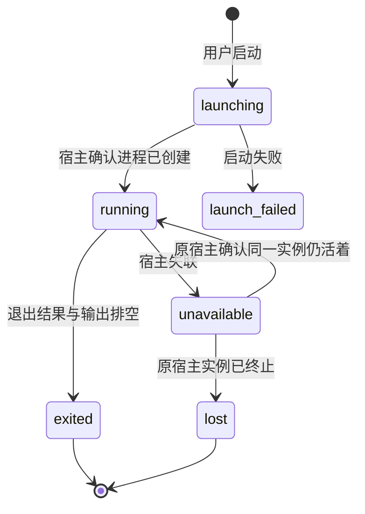

# Keepline 终端工作台产品 Spec

状态：待评审设计，尚未实现。日期：2026-10-13，2026-10-20 按产品卡调整分组、结局状态与「你在这里」卡，同日按多标签分屏用法改为工作视图 + 鸟瞰视图。源码基线：`main@6b68db97517361a743f9f79b721262cce2fbfc55`。

用户已确定的方向是「带终端的工作台 App」：看到 Agent 的状态后，可以就在 Keepline 内回答、审批、追问和继续任务。本文中的布局、首版范围与技术方案是本次提出的设计，尚未经过用户的界面验收。

产品定位、形态取舍、指标与放弃条件见 [Keepline 产品卡](../product-card.md)。本文是该定位在终端工作台上的实现规范。

阅读顺序：[产品与交互](product.md) → [技术与接口](tech.md) → [实施与验收](tasks.md)。本文是终端工作台的主规范；既有进度账本规则仍按 [progress-ledger/product.md](../progress-ledger/product.md) 执行。与本文冲突的默认入口、外部终端启动和窗口生命周期行为，以本文为目标；当前实现不会因为写入 Spec 而自动改变。

## 1. 产品定位

Keepline 是面向同时使用 Codex、Claude Code 的用户的本地 Agent 终端工作台。用户在同一个 App 中启动多个 Agent、切换工作、处理输入请求、检查结果，并在窗口关闭后继续运行任务。

核心对象是正在工作的会话。任务、进度账本、提醒和用量帮助用户判断何时进入哪个会话；终端承担实际交互。首版不实现通用终端替代品、代码编辑器或自有 Agent 推理协议。

主路径为：选择项目 → 启动 Agent → 原生 CLI 在真实 PTY 中运行 → 用户直接输入 → 切换会话或关闭窗口 → 再次进入同一终端 → 检查证据与验收。

## 2. 成功标准

1. 从项目列表启动 Codex 或 Claude Code 后，用户可以在 App 内完成一次真实对话与一次原生权限审批。
2. 用户收到某会话的提醒后，一次点击进入正确的终端；终端可操作时获得焦点。
3. 切换会话、关闭终端标签、关闭窗口及选择「退出 App，继续运行任务」均不结束后台 Agent。
4. 重新打开 App 时，仍存活的托管会话保留原来的 PID、终端 ID、画面与输入状态。
5. 退出、失联、等待输入、Agent 回合完成、任务验收分别表达，避免把进程退出当成任务完成。
6. App 内输入与后台会话逐一对应，不能因列表排序、重连或快速切换而输入到另一个会话。

这里的「后台继续」以终端宿主仍在运行、系统未退出登录或重启为前提。宿主进程崩溃和机器重启后的 CLI 恢复，是启动新进程续接历史记录；不声称保留原来的内存与执行现场。

## 3. 首版范围

### 必须交付

- macOS 桌面 App：Rust 后台进程 + GPUI 原生客户端（2026-10-20 架构修订，见 [tech.md 第 0 节](tech.md#0-2026-10-20-架构修订优先于本文其余部分)），沿用现有视觉语言。
- 两种用法（6.1）：在终端画面里由用户自己启动 Codex、Claude Code；或从待办「开始」选择 Agent，由 Keepline 启动并把待办内容放进 Agent 输入框（6.4）。
- 真正的交互式终端，包括中文输入法、多行粘贴、复制、滚动、搜索、光标、颜色、窗口缩放和原生 CLI 的交互提示。
- 空间、标签与分屏：参照 Herdr 的分割树，右键或「⋯」向右 / 向下分屏、拖动分隔线、放大还原；画面状态栏与需要你角标，后台会话保持运行。
- 鸟瞰视图：全部未闭环会话按分组铺成卡片，点卡片回到所在画面。
- 托管会话的重新连接、控制权管理、明确停止、退出码和历史会话恢复。
- 现有要求、证据、纠偏、验收、提醒、用量与终端关联。
- 外部会话仍可被观察，并清楚标出其当前不能在 App 内直接输入。
- 本地打包启动、登录环境识别、异常反馈和性能验收。

### 首版不做

SSH、远程主机、Windows/Linux 发布、把画面拖到任意位置重排的布局编辑（首版只支持向右 / 向下拆分与拖动分隔线）、广播输入、终端共享、TUI 客户端、自有聊天替代层、模型路由、代码编辑、插件系统、云同步、自动提交审批、Remem 接入、整库 Rust 重写。

这些不是可选配置或占位 UI。没有实现的能力不显示为可用入口。通用 shell 只用于研发验证，不作为首版产品入口。

## 4. 信息架构与布局

两种视图共用同一份会话数据：日常的**工作视图**和回来时的**鸟瞰视图**。设计稿见 [Keepline 工作台画布](https://claude.ai/artifact/D7QTQJmv6VZdPeqcKwHxoU)（私有链接）中的 Main 与 Overview。

### 4.1 工作视图

```text
┌──────────────────────────────────────────────────────────────────────┐
│ Keepline / lib   [鸟瞰全部 · 3 等你]  [跳到会话……]       [＋ 新待办]  │
├──────────────┬───────────────────────────────────────────────────────┤
│ 空间          │ [tes] [webs] [keepline] [codex- ●] [steal ●] [hrness ●] │
│ lib    ●2 14 ├────────────────────────────┬──────────────────────────┤
│ sys    ●1 11 │ 待核对 │ 测试 42/42 · 未提交 │ 等你回答 │ 批准 git push   │
│ 模型上线 ●1 9 │                            │       真实终端           │
│ keepline ●1 5│        真实终端             ├──────────────────────────┤
│              │                            │ 进行中 │ 运行 4 分钟       │
│ 需要你 · 5    │                            │       真实终端           │
│ ● 反馈接口    │                            │                          │
│ ● SSH 异常    │                            │                          │
│              │                            │                          │
└──────────────────────────────────────────────────────────────────────┘
```

- 第一次启动直接给一个可以输入的终端画面（目录为用户主目录或上次的项目目录），不出现欢迎页或引导流程。离开超过设定时长（默认 30 分钟）后重新打开，先显示鸟瞰视图，见 4.2。
- **左栏**只放两样：空间列表（每个空间显示等你回答、出错了的角标和会话总数）和「需要你」短列表（等你回答与出错了，单行显示，按分组规则排序）。「需要你」、空间与标签角标、菜单栏计数和通知只统计 Keepline 自己终端里的会话；外部会话只在鸟瞰视图出现。点「需要你」的条目直接切到它所在的空间、标签和画面并聚焦，与 Herdr 点侧栏的行为一致；进程已退出的，在 App 内开新画面用原 CLI 的 resume 续上。左栏不承担全部会话列表；「鸟瞰全部」与「下一个等你的」入口在顶栏；不设底栏，左栏也不重复会话数与连接状态，后台更新中时顶栏显示「正在更新…」（2026-10-23）。
- **标签**：每个空间有自己的标签行，标签上显示其中最需要你的分组颜色角标。标签关闭等于关闭视图；标签菜单中的「停止 Agent」是独立操作，不能由关闭图标代替。
- **分屏（2026-10-20 改为参照 Herdr）**：每个标签是一棵分割树。任意画面都可以**向右分屏**或**向下分屏**，可以继续嵌套；分隔线可以拖动调整比例；任一画面可以**放大**到占满标签，再还原；关闭画面时它的空间还给相邻画面。不设固定格子，也不设数量上限。入口是**在画面上右键**弹出的画面菜单，同样的菜单也放在画面状态栏的「⋯」里（满足每个功能都有可见按钮）。只有一个画面时不画分屏边框。只有当前标签中可见的画面绘制；其他会话在后台继续解析输出，不绘制。聚焦的画面有明显边框，键盘输入只进入聚焦画面。新分出的画面是一个空 shell，目录沿用被拆分的画面。
- **画面菜单（右键与「⋯」相同）**：向右分屏、向下分屏、放大 / 还原、为这个待办开一个会话（仅待办的标签，带 Agent 选择，同 6.4）、复制、粘贴、搜索滚动内容、挂到待办… / 取消关联、中断（Ctrl-C）、停止 Agent、关闭画面。
- **左栏的待办**：空间列表与「需要你」之间，显示当前空间的待办（进行中、还没开始、等你验收），还没开始的带「开始」按钮，旁边的「＋」新建待办。
- **待办信息条**：当前标签是某条待办的标签时，标签行下方显示一条：待办名、验收进度（几条有证据）、会话数，以及「待办详情」「标记待办完成」按钮。普通标签不显示。
- **画面状态栏**：每个画面顶部一行，依次是分组标签、一句「你在这里」摘要（取「停在」或「做成了」中最关键的一项）、Agent / 项目 / 时间和「你在这里」按钮。连接与输入状态（已连接、只读、断开）也在这一行表达。
- **「你在这里」卡**按需弹出，锚定在对应画面上，不常驻占一栏。固定四个字段：

  | 字段 | 内容 | 来源与规则 |
  |---|---|---|
  | 你要它 | 用户原话，含追加要求 | 原文，不改写 |
  | 做成了 | 退出码、测试结果、文件改动、提交 | 只认机械证据，Agent 自述不算 |
  | 停在 | 最后一轮的工具调用、错误或明确的输入请求 | 机械提取优先 |
  | 下一步 | 由上三项推导，可选模型摘要 | 标明是推断，不得编造证据 |

  卡片和状态栏摘要每轮结束时更新，终端输出本身不触发重算。CLI 自己输出的回合总结（如 Codex 的 Recap / Next）属于 Agent 自述，可以作为「停在」「下一步」的参考来源，不得进入「做成了」。卡片下方是结局操作（完成、暂存、放弃）；要求编辑与逐项验收、完整账本、待办、目标、回顾和用量保留二级入口。字段的提取规则沿用轻量接手规则，见 [progress-ledger/product.md](../progress-ledger/product.md#lightweight-handoff-2026-10-18)。
- 中央终端区沿用现有字体、间距、状态色，不在此次新增主题系统。
- 首版主窗口最小尺寸建议为 960 × 640，默认 1280 × 820；窗口过窄时先合并为单画面并保留状态栏，不能把终端压成不可输入的窄条。菜单栏继续使用紧凑摘要。
- **每个功能都必须有看得见的按钮**（2026-10-20 用户要求）：用户不一定知道快捷键，所以按钮是唯一必需的入口。首版先不做应用快捷键；以后加快捷键时只能作为按钮的补充，并在按钮的提示里写出来，不能有只能靠快捷键触发的功能。键盘输入全部交给聚焦的终端画面，只保留 macOS 标准的复制（⌘C）与粘贴（⌘V），复制粘贴同时在画面右键菜单里提供。
- 功能与按钮位置对照（首版）：

  | 功能 | 按钮位置 |
  |---|---|
  | 新建标签 | 标签行末尾的「＋」 |
  | 分屏（向右 / 向下）、放大 / 还原 | 画面右键菜单与状态栏「⋯」；分隔线可拖动 |
  | 关闭画面 / 标签 | 画面状态栏的「×」、标签上的「×」（只关视图，不停 Agent） |
  | 停止 Agent、中断、搜索滚动内容、复制 / 粘贴 | 画面右键菜单与状态栏「⋯」 |
  | 打开鸟瞰 / 回到工作区 | 顶栏「鸟瞰全部」、鸟瞰页顶部「回到工作区」 |
  | 跳到下一个等你的会话 | 顶栏「下一个等你的 · N」 |
  | 跳到某个会话 | 顶栏搜索框 |
  | 「你在这里」卡 | 画面状态栏的「你在这里」 |
  | 完成 / 暂存 / 放弃 / 撤销结局 | 「你在这里」卡底部、鸟瞰卡片的「⋯」菜单 |
  | 继续已退出的会话 | 「你在这里」卡与鸟瞰卡片上的「继续」（新开画面并启动 resume）与「复制命令」 |
| 新建待办 | 顶栏与左栏待办区的「＋ 新待办」 |
| 从待办开始 / 再开一个会话 | 左栏待办、鸟瞰待办卡片、待办详情的「开始」；待办标签里画面菜单的「为这个待办开一个会话」 |
| 待办详情、标记待办完成 | 待办信息条、左栏待办、鸟瞰待办卡片 |
| 挂到待办 / 取消关联 | 画面右键菜单与状态栏「⋯」 |
  | 逐个清理 | 鸟瞰底部「很久没动 → 逐个清理」，页内「上一个」「跳过」 |
  | 筛选空间、只看有变化 | 鸟瞰顶部的空间标签与复选框 |
  | 设置 | 顶栏设置按钮 |

### 4.2 鸟瞰视图

```text
┌──────────────────────────────────────────────────────────────────────┐
│ 欢迎回来，你离开了 3 小时 · 期间 7 个有变化 · 46 个未闭环   [全部][lib]… │
│ ● 等你回答 3   [卡片][卡片][卡片]                                      │
│ ● 出错了 2     [卡片][卡片]                                            │
│ ● 待核对 5     [卡片][卡片][卡片][卡片][卡片]                           │
│ ● 做一半停了 4 [卡片][卡片][卡片][卡片]                                 │
│ ● 进行中 6     [卡片]…（弱化显示）                                      │
│ 很久没动 26 → 逐个清理 · 暂存 5（1 个今天到期）· 已结束 121              │
└──────────────────────────────────────────────────────────────────────┘
```

- 顶部是「待办 · 还没开始」一行：每条待办一张卡片，带「开始」（含 Agent 选择）、「详情」「⋯」（暂存、放弃、编辑），以及「＋ 新待办」。会话卡片上显示所属待办的名字。
- 所有未闭环会话按 [5. 收件箱分组](#收件箱分组) 分区，每个会话一张小卡片：标题、空间与 Agent、一句状态（与画面状态栏相同）；离开后有变化的标「新」。卡片网格按窗口宽度自适应列数，默认窗口下 40 张卡一屏放得下。
- 「很久没动」「暂存」「已结束」折叠成计数；「很久没动」进入逐个清理（每个会话一屏，显示「你在这里」卡，选择继续、完成、暂存或放弃）。
- 可按空间筛选，可只看离开后有变化的会话。
- 点卡片：会话在某个标签的画面里时，切到该空间、标签并聚焦该画面；不在任何画面里时，在当前空间新开标签打开；外部会话按第 5 节和第 6.6 节规则处理。
- 鸟瞰视图只读，不在卡片上直接输入或审批。

### 4.3 对象关系：做什么与放在哪

两套关系分开定义，只在「会话跑在某个终端里」这一点相连。

| 对象 | 是什么 | 对应关系 |
|---|---|---|
| 空间 | 一个项目目录 | 有多条待办、多个标签 |
| 待办 | 一件要交给 Agent 的事，带说明与可选的验收标准 | 属于一个空间；对应 0 到多个会话 |
| 会话 | 一次 Agent 对话（原 CLI 的一个会话 ID），有结局 | 最多属于一条待办；同一时刻只跑在一个终端里 |
| 标签 | 一组摆在一起的画面，按分割树排列 | 属于一个空间；画面数量不限 |
| 画面 | 屏幕上的一个格子 | 显示一个终端 |
| 终端 | 后台托管的一个 PTY | 可以先后跑多个会话，状态栏显示当前那个 |

**核心规则**：会话算哪件事，看它挂在哪条待办上；显示在哪，看它在哪个画面里。两者互不推导。

- 待办进度、待办详情的关联会话、鸟瞰卡片上的待办名，都按会话所属的待办计算，与摆放无关。
- 把画面拖到别的标签，归属不变；只有画面「⋯」菜单里的「挂到待办…」「取消关联」会改变归属。
- 不同待办的会话可以并排放在同一个标签里对照。

**默认行为（让多数时候「一个标签就是一条待办」）**：

1. 点待办的「开始」，在待办所属空间里新建这条待办的标签（界面上叫「待办的标签」），标签名就是待办名，放第一个画面并启动所选 Agent，见 6.4。
2. 给这条待办「再开一个会话」，在它的标签里把当前聚焦的画面向右分屏放进去（从画面菜单发起时按所选方向）；不设数量上限。
3. 在待办的标签里用「＋」或分屏开空终端，里面新启动的 Agent 会话默认挂到这条待办上，可以取消；普通标签里的会话不挂任何待办。
4. 标签名：标签里所有会话都属于同一条待办时显示待办名；混合或都没挂待办时，显示用户起的名字，没有就用目录名。

**边界情况**：

| 情况 | 处理 |
|---|---|
| 关掉待办的标签 | 只收起视图，会话照常运行，待办不受影响；从左栏、鸟瞰或待办详情再点一下，按原来的分屏布局重新打开 |
| 一个终端里先后跑了两个 Agent | 两个会话分别算，可以挂到不同待办 |
| 会话不在任何画面里（老会话、外部终端里的会话） | 照样属于它的待办，在鸟瞰里可见；点「继续」时在它待办的标签里开画面 |
| 待办标记完成 | 只记录用户判断，不关闭标签、不停止会话 |
| 待办与标签分属不同空间 | 可以手动摆放；「开始」默认在待办自己的空间里打开 |

## 5. 会话类型与状态

### 托管与外部

| 类型 | 启动来源 | App 内输入 | 默认点击行为 |
|---|---|---|---|
| 托管会话 | Keepline 终端宿主启动 | 可以，需持有控制权 | 打开同一个真实终端 |
| 外部会话 | 用户已有的 Terminal / iTerm / Warp 等 | 不可以直接接管 | 仅在鸟瞰视图出现；打开记录，显示外部来源与可用操作 |

2026-10-21 定案：外部会话是 Keepline 扫描 CLI 日志发现、但不在自己终端里的会话。它们不进入「需要你」、空间与标签角标、菜单栏计数和通知，因为 Keepline 无法把用户带到那个终端；只在鸟瞰视图作为记录保留。否定的替代：点击后整页换成详情（替换掉正在用的终端）、侧栏旁弹卡片再跳外部终端（Ghostty 只能按目录猜标签，会跳错）。验证：waiting-capture 40 会话夹具（托管 2 个等你回答；外部 4 个等你回答、4 个出错）中「需要你」只列 2 个托管会话，其他空间无角标；用户在隔离窗口中从「tes」标签点「诊断 SSH 执行异常」，切回「CLI 问题反馈」并聚焦对应画面。

不能把「读到了会话日志」显示成「已接管终端」。外部活跃会话不提供一键复制运行；已明确退出后，可通过原 CLI 的 resume 在 App 中恢复。状态未知时先核实，不自动产生第二个执行者。用户需要另开任务时通过普通新建入口启动独立会话，不伪装成接管。

### 三种独立状态

| 维度 | 示例 | 事实来源 |
|---|---|---|
| 终端进程 | 启动中、运行、结束、宿主失联 | 终端宿主的进程句柄与退出结果 |
| 界面连接 | 连接中、恢复画面、可输入、只读、断开 | 连接、快照、控制权与输入确认 |
| 工作进度 | 正在推进、需要输入、待核对、已验收 | 原始日志、Hooks、已关联画面静止时的屏幕兜底（仅需要输入）、账本与用户操作 |
| 结局 | 未闭环、已完成、暂存、已放弃 | 仅用户操作，存于 Keepline SQLite |

同一会话可以是「进程运行、终端可输入、工作待核对」。不能把状态硬压成一个枚举。底部优先显示阻止交互的问题；详情保留事实来源。

### 结局状态

每个会话都必须有结局；没有结局的都算「未闭环」，一直留在鸟瞰视图里，直到用户处理。

| 结局 | 含义 | 谁来设 | 鸟瞰视图中的表现 |
|---|---|---|---|
| 未闭环 | 默认值 | 系统 | 按下方分组规则出现 |
| 已完成 | 用户核对并验收；沿用现有账本的验收语义 | 仅用户 | 移入「已结束」 |
| 暂存 | 必须填写原因和再看时间 | 仅用户 | 进入「暂存」；到期后回到未闭环并标出「到期」 |
| 已放弃 | 不再处理，可选原因 | 仅用户 | 移入「已结束」 |

- 结局与进程状态互不推导：进程退出不等于完成，标记完成也不停止进程。对仍在运行的会话标记完成或放弃时，提示用户是否另外停止 Agent，不自动停止。
- 已完成、暂存、已放弃的会话出现新回合时，回到未闭环，并保留原结局记录供查看。
- 结局可撤销，撤销后回到未闭环。

### 收件箱分组

未闭环会话先判断是否「很久没动」：不在运行回合，且超过设定天数（默认 3 天）没有新回合，就归入「很久没动」；暂存到期的会话从到期时间起算。其余会话按下表从上到下归入第一个匹配的分组：

| 分组 | 条件 | 默认 |
|---|---|---|
| 等你回答 | 有明确的输入请求：审批、提问、选择菜单（日志记录，或已关联画面的屏幕兜底，见 6.3） | 展开 |
| 出错了 | 最后一轮以错误结束、进程非零退出，或会话为 lost | 展开 |
| 待核对 | Agent 回合已结束且声称完成，等待用户验收 | 展开 |
| 做一半停了 | 进程已结束或空闲，既没有完成声明，也没有输入请求 | 展开 |
| 进行中 | Agent 正在运行回合 | 折叠 |

「很久没动」排在以上分组之后，默认折叠，提供逐个清理入口：每个会话一屏，显示「你在这里」卡，用户选择继续、完成、暂存或放弃。

另有「暂存」和「已结束」两个分组，默认折叠。组内按最近变化时间倒序。同一套分组同时用于鸟瞰视图分区、左栏「需要你」短列表、画面状态栏和标签 / 空间角标。分组只由事实和用户结局决定，重新分组不改变当前打开的标签和聚焦画面。



从 `exited/lost` 恢复会话时创建新的终端记录，与原记录建立续接关系，不能把旧终端改回 running。

## 6. 核心用户流程

### 6.1 新建：两种用法（2026-10-21 改，取消预填命令）

调研见 [research/waiting-and-capture-20261021.md](research/waiting-and-capture-20261021.md) 与本节下方「为什么不预填」。两种用法最终都落到同一个真实终端里。

**用法一：从待办开始。** 点待办的「开始」，弹出 Agent 选择（Codex / Claude Code，上次用的排前面）。选定后在待办的标签里开新画面，Keepline 直接在这个画面的 shell 里启动所选 Agent。Agent 进入可输入状态后，把待办内容放进 **Agent 自己的输入框，不按回车**；用户在 Agent 的编辑区里检查、修改，自己按回车发出。会话自动挂到这条待办。详见 6.4。

**用法二：直接用终端。** 标签行「＋」、画面菜单的「向右 / 向下分屏」开的是普通 shell，用户敲什么都行（`codex`、`claude`、`git` …）。Keepline 识别到其中跑起了 Agent，就把它当作会话跟踪（分组、等你回答、「你在这里」），**不要求先建待办**：
- 画面所在标签属于某条待办时，会话自动挂上去；
- 否则就是没有待办的会话，照样出现在鸟瞰和「需要你」里；
- 想补挂，用画面菜单「挂到待办…」，或在会话卡上「存为待办」（首句原话做标题）。
- 画面属于某条待办、而 Agent 是用户手动启动的，状态栏出现「放入待办内容」：点了才放进 Agent 输入框，同样不按回车。

| 入口 | 新画面开在哪 | 目录 | Keepline 做什么 |
|---|---|---|---|
| 标签行「＋」 | 新标签 | 当前空间的项目目录 | 只开 shell |
| 画面菜单的「向右 / 向下分屏」 | 当前标签，拆分被选中的画面 | 被拆分画面的目录 | 只开 shell |
| 待办的「开始」「再开一个会话」 | 待办的标签，规则见 4.3 | 待办所属项目目录 | 启动所选 Agent，就绪后放入待办内容（不回车） |
| 「继续」已退出的会话 | 会话所属待办的标签；没有待办则新标签 | 原会话目录 | 启动 `codex resume <id>` / `claude --resume <id>`；同时提供「复制命令」 |

- **提示词只进 Agent 的输入框，不拼进 shell 命令。** 多行、中文、引号都由 Agent 自己的编辑区处理；空着的字段不放（没有验收标准就不出现「验收标准：」）。
- **发不发由用户决定**：Keepline 启动 Agent（启动一个可对话的 CLI 不会执行任何改动），但从不替用户按发送；Agent 的工具调用仍走它自己的审批。
- **就绪判断**：Agent 打开了 bracketed paste 且屏幕上没有选择菜单（目录信任、登录等），输出静止后才放入。超过 60 秒仍未就绪就不放，画面上方提示「Agent 还没准备好，内容没有放进去」，并给「复制内容」「再试一次」。
- 启动命令不再带 `--no-daemon`（共享守护进程模式下也能关联，见 R15）；Claude 带 `--session-id <uuid>` 以便确定关联。
- CLI 的目录信任、登录、模型选择和权限请求都在原生终端界面里完成；关联失败不得阻塞打字。
- 不会自动开启跳过权限或危险模式。

**为什么不预填命令（2026-10-21 用户实测）**：旧设计把「标题 + 说明 + 验收标准」拼成带单引号的 shell 参数预填在命令行。用户看不见引号边界，在右引号后补写内容，变成多余参数，codex 报错。同类产品都不这样做：Herdr 先 `agent start` 等 Agent 可输入，再 `agent prompt` 把文字送进 Agent；Claude Squad 直接启动程序，就绪后把提示词写进 Agent 输入框（源码 `session/instance.go` 的 `SendPrompt`）；Superset、cmux 让用户自己敲；Vibe Kanban、Conductor、Codex App 走自己的输入框。

### 6.2 正常工作与会话切换

- 键盘、粘贴、鼠标终端事件只发送给当前聚焦、连接完成且持有控制权的那一个画面；同一标签内其他可见画面继续显示输出，不接收输入。
- 会话排序变化不改变当前终端；切换后恢复该终端的滚动位置和输入状态。
- 搜索框和账本编辑器有焦点时，文字不进入终端。
- 切到后台的终端继续处理输出；不继续绘制不可见画面。当前标签内可见的画面（最多 4 个）各自绘制。
- 原生 slash command、模型选择和 Agent 自己的多行编辑遵循原 CLI 行为，不在 App 再造一套输入框。

### 6.3 需要输入与审批

通知 / 菜单栏 / 鸟瞰卡片 / 「需要你」列表 → 切到会话所在空间、标签和画面 → 该画面聚焦 → 用户在 CLI 原生界面处理。

2026-10-21 定案（调研见 [research/waiting-and-capture-20261021.md](research/waiting-and-capture-20261021.md)）：**不弹模态，不在终端外提交答案；把「找到它」和「答之前看清」做好。** 画面就在同一窗口里，进终端作答只多一次点击；Keepline 拿不到 Claude / Codex 的结构化审批事件，模拟按键在误判时会把字打进审批框；Claude Code 官方也不允许在会话外回答权限对话框。

1. **识别**：「等你回答」的事实来源按优先级为日志里的结构化提问 / 审批记录，其次是**已关联 Agent 画面的屏幕兜底**：该画面输出静止约 1 秒后，后台检查一次屏幕底部若干行是否匹配已知的审批或选择题样式（例如 Claude Code 的 `Do you want to …?` 加编号选项、Codex 的审批菜单）。规则从严，匹配不到就不标，宁可漏标不误标；只在输出静止时检查一次，不逐帧解析；画面有新输出或用户在该画面输入后撤销该标记。未关联 Agent 的普通 shell 不做检查。
2. **找到它**：等你回答的会话进入左栏「需要你」、标签与空间角标、菜单栏，并排在最前。
3. **答之前看清**：画面状态栏的摘要显示要批的命令或问题本身（取自日志，或屏幕兜底匹配到的那一行问题）；「你在这里」卡显示仓库、命令与最近改动。
4. **作答**：点击后切到该画面并聚焦，用户直接在原生提示里按选项或输入。首版不提供「同意」按钮，不根据文本自动发送 `y`、数字或 Enter。外部会话不进入这条路径（见第 5 节「托管与外部」），鸟瞰里打开它的记录时不能显示假的可输入框。
5. **通知降噪**：只对「等你回答」和「出错了」发；该画面正被聚焦且 App 在前台时不发；同一事件只发一次；正文写明项目与要批的内容。
6. 以后若接入结构化事件（例如用户自愿安装 Hook），可以考虑选择题的快速回复；权限审批仍进画面处理。

通知去重和用户验收沿用现有语义。通知点击、终端连接、原 CLI 实际收到输入分别验收。

### 6.4 从待办开始

1. 用户在左栏、鸟瞰或待办详情点「开始」，弹出 Agent 选择：Codex / Claude Code，上次用的排前面。
2. 待办还没有标签时，在它的空间里新建待办的标签；已经有标签时切过去，并把聚焦画面向右分屏放进去。同一条待办重复点「开始」，切回已有的画面，不重复开。
3. 新画面 `cd` 到待办所属目录，Keepline 在 shell 里启动所选 Agent；就绪后把待办内容放进 Agent 输入框，不按回车。画面上方一行说明随状态变化：「正在启动 Codex…」→「已放入待办内容，检查后按回车发送」/「Agent 还没准备好，内容没有放进去」，并提供「复制内容」「再试一次」「不关联待办」。
4. 识别到 Agent 会话即自动挂到这条待办；选择「不关联待办」时不挂。
5. Agent 自称完成后进入待核对；待办的完成只由用户在待办信息条或待办详情里标记。完成待办不关闭标签、不停止会话。

沿用现有派发 ID 做去重：同一次「开始」的重试不创建重复画面。

**新建待办（2026-10-21 改为一行快速输入）**：顶栏或左栏的「＋ 新待办」不再弹整页表单，而是在左栏待办区顶部出现一行输入框，只填「要做什么」；项目默认当前空间，Agent 默认上次的选择。同一行有「保存」「保存并开始」「展开」「取消」四个按钮。「展开」才露出「在哪个项目里做」「说明（原样交给 Agent）」「验收标准（可选，逐条）」「默认 Agent」。输入框内按回车等同「保存」，Esc 等同「取消」（输入框内的编辑键，不算 App 快捷键）。

- 验收标准不在记录时强制。点「开始」时若还没有验收标准，说明行多一句「还没写验收标准」并给「补写」入口，不阻止开始。
- 同一空间的待办列表就是队列，按创建顺序排列；不另做 prompt 队列，也不替代 CLI 自己的排队行为。

**待办详情**：说明、验收标准（每条标出是否已有机械证据）、关联会话列表（可直接打开）、「再开一个会话」以及「标记完成 / 暂存 / 放弃 / 编辑」。

### 6.5 关闭与退出

| 用户动作 | 结果 |
|---|---|
| 切换页面 / 关闭标签 / 关闭主窗口 | 释放对应视图，后台终端继续运行 |
| 退出 App，继续运行任务 | App 退出，终端宿主继续；App 不在后台替用户接收系统通知 |
| 退出并停止所有任务 | 展示受影响会话，用户确认后逐个停止，确认退出结果后关闭宿主与 App |
| 单个会话「中断」或 Ctrl+C | 交给当前前台进程组 / CLI 处理，不保证进程退出 |
| 单个会话「停止 Agent」 | 先正常终止；仍未退出时由用户选择强制停止 |

没有托管活跃会话时 App 直接退出。后台宿主没有会话且无客户端后可自行退出。关闭 macOS 红色按钮不弹终止确认；真正终止运行中的任务才需要确认。

### 6.6 恢复与重新连接

- **重新连接**：宿主还活着，打开同一个终端 ID / PID，恢复画面后继续输入，不启动 CLI。
- **CLI 恢复**：原进程已明确结束时，按 6.1「继续」入口新开画面并启动 resume 命令；「你在这里」卡同时提供「复制命令」。由 CLI 决定能恢复哪些对话内容。
- **新建**：无法 resume 时，明确告知用户将开始新会话；不能自动降级并声称恢复成功。
- **宿主失联**：先禁用输入、显示最后画面及其时间；不得清空记录，也不得因为超时就自动重启同一任务。
- **App 更新**：运行中会话存在时推迟终端宿主更新，或由用户明确选择停止后更新；不进行活跃 PTY 的进程间迁移。

## 7. 终端交互契约

- 支持中文 IME 组合输入，候选词选择期间 Enter 不提交给 Agent；组合完成内容只发送一次。
- Cmd+C / Cmd+V 用于复制和粘贴；Ctrl+C 是终端中断，原样交给 CLI。搜索滚动内容、新建标签、关闭视图都从按钮或画面菜单进入；首版不设 Cmd+F、Cmd+T、Cmd+W 等应用快捷键。
- 复制选区仅取终端文本。粘贴通过终端的 bracketed paste 语义处理，不自动追加提交换行；原剪贴板换行按原样保留。
- 大于单次传输帧的粘贴分块发送，不能静默截断或插入额外 Enter。
- 显示完整颜色、光标及普通/备用屏幕；支持 Codex / Claude 的选择菜单、流式重绘和鼠标终端操作。
- 终端区域滚动不导致整个工作台跳动；输出到达时，用户已滚离底部则保持位置，提供回到底部入口。
- 每个会话保留最近 5,000 行滚动文本，达到上限后丢弃最旧滚动行，不影响当前屏幕；历史对话仍以原 CLI 日志为准，不承诺保存所有 shell 原始字节。
- 断线或输入确认不明时，禁用后续发送并提示；不自动重放可能已经执行的输入。
- 链接需要明确点击后由系统浏览器打开；终端输出不能自动打开 URL、改写剪贴板或执行本机命令。

## 8. 首次使用、设置与可访问性

- 检查 CLI 是否存在；未安装时提供官方安装说明。已经安装但未登录时打开正常 CLI 登录流程，不拷贝凭证。
- App 从 Finder 启动也要识别用户常用 CLI 路径。解析登录环境失败时给出具体提示，不修改用户 shell 配置、`.env` 或密钥。
- 保留现有监测与通知开关；此次不新增运行时后端选择、终端协议模式或自动批准设置。
- 无障碍标签覆盖新建、会话切换、断开、只读、停止和通知；支持全键盘导航。终端无障碍阅读由选定组件能力验证，不能只凭 DOM 测试判定通过。
- 终端正文支持现有字体缩放方式；没有使用中的会话时说明下一步，故障时保留可读的记录和可重试操作。

## 9. 数据、隐私与依赖

终端输出、用户输入和 CLI 凭证只在本机。终端内容不默认发送给模型分析、遥测或 Remem。已有模型辅助账本仍遵循单独的配置与内容范围。

原生 CLI 日志是对话事实来源；终端宿主是活跃进程、输入控制权和当前终端画面的事实来源；Keepline SQLite 是任务与用户验收的事实来源。

保留期只作用于结束会话的派生数据。活跃终端不能因为用户缩短账本保留期被停止或消失。原 CLI 原始日志、项目文件和用户 Hook 不由本次实现删除或改写。

## 10. 首版验收清单

| ID | 场景 | 必须观察到的结果 |
|---|---|---|
| A01 | 从 Finder 冷启动，已有大量历史记录 | 先可见工作台并可启动新 Agent，历史加载不阻塞终端 |
| A02 | 启动两个不同项目的 Codex / Claude | 两个真实 PTY，输入和工作目录不串线 |
| A03 | 中文输入法、多行及大段粘贴 | 原 CLI 收到准确且只出现一次的输入 |
| A04 | 处理一次真实权限请求与一次选择菜单 | 可以直接完成；不由 App 代批 |
| A05 | 快速切换标签与画面、同一标签 4 个画面同时输出、后台输出、缩放、备用屏幕 | 原会话继续，画面和键盘行为正确；输入只进入聚焦画面 |
| A06 | 关闭标签、窗口，退出 App 后重新打开 | 同一个终端 ID / PID 可继续工作 |
| A07 | 客户端重启、传输断线、输入确认丢失 | 画面可由后台快照恢复；可能已执行的输入不被自动重放 |
| A08 | 从待办开始和重复点击 | 一次「开始」至多开一个画面；先选 Agent，Keepline 启动它并把待办内容放进 Agent 输入框，不替用户按发送；会话正确挂到待办 |
| A09 | 托管会话与外部会话同时等你回答；点通知与「需要你」条目 | 只有托管会话发通知、进「需要你」和角标，点击直接聚焦其画面；外部会话只在鸟瞰出现 |
| A10 | 子进程正常退出、强制停止、宿主被杀 | 状态正确，输出排空，无假成功、自动重启或遗留托管进程 |
| A11 | 同一会话出现第二个界面 | 只有一个写入者；另一个只读或用户明确接管 |
| A12 | CLI 恢复已退出会话 | 创建新终端、保留续接关系；不伪造原 PID 存活 |
| A13 | 终端乱码、异常控制序列、恶意链接 | 不执行页面脚本、不绕过审批、不自动开链接或写剪贴板 |
| A14 | 规定负载下性能与长期驻留 | 已推迟（2026-10-22 用户决定，不阻塞首版）：首版只要求窗口隐藏不渲染、空闲无轮询和长期驻留不增长；相对 Ghostty ≤ 1.2 倍首版后再处理 |
| A15 | 收件箱分组与结局：等待输入、出错、声称完成、空闲未完成、超期各一个会话；分别标记完成、暂存、放弃，并让一个暂存到期、一个已完成会话出现新回合 | 各会话进入规定分组；暂存到期与新回合使会话回到未闭环；结局不停止进程，进程退出也不产生结局 |
| A16 | 「你在这里」卡与画面状态栏 | 四个字段均有内容或明确的「无」；「做成了」只列机械证据，CLI 回合总结不进入「做成了」；终端持续输出期间卡片与状态栏不重算 |
| A17 | 离开超过设定时长后重新打开；40 个未闭环会话分布在多个空间与标签 | 先显示鸟瞰视图，分区与计数正确，「新」标记只出现在离开后有变化的会话；点卡片切到正确的空间、标签和画面并聚焦；左栏「需要你」与标签 / 空间角标与鸟瞰一致 |
| A18 | 中文输入法清单（拼音组字、候选窗位置、组字中回车与退格、中英切换），在 GPUI 客户端可见的 4 个画面中逐一完成 | 全部通过；不通过则按 tech.md 第 0 节切换备选 |
| A19 | 对象关系：从待办开始两次、再开一个会话、把画面拖到别的标签、关掉待办的标签后从左栏重新打开、在普通标签里启动 Agent | 不重复开画面；第二个会话分屏进同一标签；拖动不改归属；关标签不停会话且布局恢复；普通标签里的会话不挂待办；待办内容从不被自动发送 |

A01–A19 与实际 Codex、Claude 两种运行时对应的测试全部满足后，才可以称为「首版终端工作台完成」。签名、公证、正式发布和用户创意验收另有回执，不能以软件测试替代。
