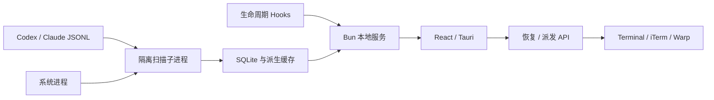
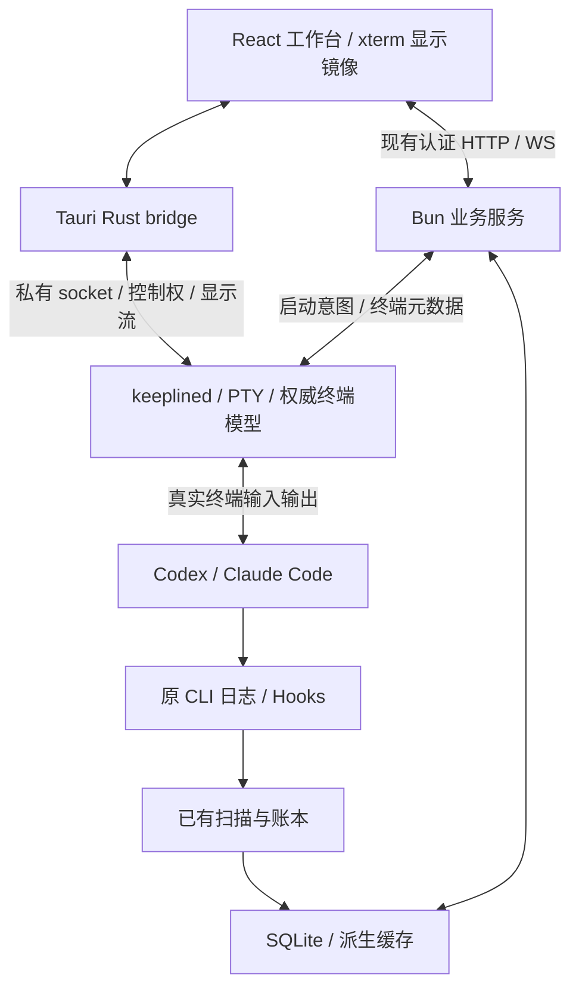

# Keepline 终端工作台技术 Spec

状态：设计建议，尚未实现；2026-10-20 架构修订见第 0 节，优先于本文其余部分。基线与产品范围见 [product.md](product.md)。实施顺序见 [tasks.md](tasks.md)。产品定位见 [产品卡](../product-card.md)。

## 0. 2026-10-20 架构修订（优先于本文其余部分）

依据开源库测评（分支 `claude/terminal-eval-04a203` 的 `eval/terminal/`）与 [产品卡第 3.1 节](../product-card.md#31-技术架构与资源预算2026-10-20-定案)。下列决定取代本文对应内容；与第 0 节冲突的段落一律以第 0 节为准。

| 编号 | 新决定 | 取代 |
|---|---|---|
| N01 | 常驻部分全部进一个 Rust 后台进程：PTY、终端状态、会话复用协议、会话记录读取、Hook 接收、「你在这里」卡、结局状态与 SQLite。Bun 服务不再常驻；读取会话记录改为按偏移增量读取并事件驱动，不轮询，不在内存中保留完整记录 | D02 中「Bun 仍拥有业务持久化、不整库搬入 Rust」；第 3、4、8 节中 Bun 业务服务的职责 |
| N02 | 界面为 GPUI（Rust）原生客户端，可替换；窗口关闭即断开，后台不受影响 | D01（Tauri + React）；第 8 节桌面桥；第 9 节中 Tauri origin 相关条目 |
| N03 | 终端状态用 libghostty-vt（锁 commit，构建引入 Zig）：后台持有全部会话的状态与快照；客户端只对可见画面（最多 4 个）用 libghostty-vt 解析，再由 GPUI 自绘 | D03（alacritty_terminal + xterm.js 显示镜像）；第 7 节中 xterm.js 相关条目 |
| N04 | 客户端与后台走自写协议（kl-relay 演进）：attach 时先发 libghostty-vt 快照，再转发字节；输入走同一连接并保留控制权租约 | D04 中 React ↔ Tauri bridge ↔ socket 的路径；第 6 节协议沿用并扩展快照帧 |
| N05 | 资源预算改为同机同负载相对 Ghostty ≤ 1.2 倍：内存用 phys_footprint，覆盖全部子进程与系统辅助进程；CPU 用累计 CPU 时间。窗口隐藏时不渲染、CPU 接近 0；空闲无轮询 | 第 10 节的绝对预算（500/800 MiB 等），测量方法仍沿用 |
| N06 | GPUI 需要补丁：窗口可见且无变化时暂停显示链接（实测空闲 CPU 从 0.8% 降到 0.07%）；维护 GPUI 补丁或分支，锁定 Zed rev 或 gpui-kit 之一 | 无 |

首个实现必须验收、测评中未完成的项：中文输入法清单（硬门槛，参考 zed#59882、#53537）；补丁空闲阈值（0.5 s）下 4 画面断续输出的 CPU；4 画面的 Ghostty 基准；GPU、耗电与输入延迟；Claude Code 全屏重绘的真实负载。中文输入法不过关且短期修不好、空闲补丁无法维护或 4 画面超预算时，切换到备选 Swift + GhosttyKit（客户端改为 Swift，后台与协议不变）。


## 1. 现状与差距

当前 `main@6b68db9` 主要是观察链路：



| 已有代码 | 当前能力 | 本次处理 |
|---|---|---|
| `src/services/service-runtime.ts` | 本地 HTTP/WS、隔离扫描、文件监听、启动对齐 | 保留业务宿主；终端不受历史扫描启动屏障影响 |
| `src/services/terminal.ts` | 打开外部终端运行命令 | 交互入口改为托管启动；不继续用 AppleScript 驱动 App 内输入 |
| `src/services/task-dispatch.service.ts` | 派发 ID、去重、会话关联、外部启动 | 复用派发语义，替换桌面派发的启动边界 |
| `src/adapters/runtimes/` 与 `recovery.service.ts` | 运行时描述、结构化恢复命令 | 复用命令构造，resume 仍由原 CLI 承担 |
| `src/services/ledger/`、数据库仓库 | 要求、证据、状态、验收、提醒 | 保留领域语义，新增终端关联，不改完成判定 |
| `menubar-tauri/src-tauri/src/ledger_app.rs` | 桌面窗口、服务连接、通知通道 | 增加终端宿主连接与流式 IPC，修订退出语义 |
| `next/crates/keeplined` | 独立 Rust PTY、Unix socket、同 UID、输入租约、缩放、退出与断连 | 作为终端宿主起点，补齐 App 所需协议与生命周期 |
| `specs/GH120/m0-managed-pty.md` | 实验原型边界与测试契约 | 保留历史事实；本文定义后续 App 范围，不声称完成整个 #120 |

M0 的 `Delta` 是带版本的完整文本视图，不是完整终端状态增量。文本、checksum 和几何尺寸不能还原颜色、光标、输入模式、备用屏幕和完整 Unicode；现有零宽字符只取一个的输出也不能用作最终屏幕协议。必须先补齐终端显示契约，再连接真实 Agent。

## 2. 架构决定

### D01. App 为主入口，沿用 Tauri + React

> **已被第 0 节取代（2026-10-20）**，以下保留为历史设计。


复用工作台 UI、菜单栏、通知和账本。不在本次引入 Electron、原生 AppKit/Metal 渲染器或独立 TUI。浏览器入口保留观察能力；首版写入控制只从授权的桌面窗口开放。

### D02. PTY 由独立 Rust `keeplined` 持有

扩展已有原型，而不是在 WebView 或短命扫描子进程里持有 PTY。App 崩溃、关闭以及 Bun HTTP 服务重启均不主动关闭这个宿主。

Bun 1.3.14 在本机有 `Bun.Terminal`，官方也提供 PTY 接口，但这不证明其在当前打包、作业控制、输出背压与守护生命周期要求下已经可用。本次不再实现一个并行的 Bun PTY 后端。Rust 原型已有真实进程组、同 UID 边界、部分写入和租约代码，复用它可以避免重复两个终端宿主。

不将任务、账本、全部 SQLite 仓库搬入 Rust。首版增加的独立职责只有终端宿主，Bun 仍拥有业务持久化。

### D03. Rust 为终端状态事实源，显示组件采用 xterm.js 镜像

> **已被第 0 节取代（2026-10-20）**，以下保留为历史设计。


沿用 Rust 中的 `alacritty_terminal` 解析 PTY，处理终端设备查询和状态；扩展其导出结构。桌面端优先集成 xterm.js 的成熟输入、绘制、选择、IME 和可访问性能力。

**浏览器收到的是由权威终端模型生成的安全显示序列，不是未经处理的 PTY 原始字节。** Rust 将当前状态、必要模式与变更编码为可被 xterm.js 显示的 VT 序列。设备查询、剪贴板请求、未知 OSC 和自动打开链接请求不转发为浏览器动作。

这样 CLI 的设备查询始终只有 Rust 回答，前端不会因再次解析原始查询而重复回复。xterm.js 只保存显示镜像，不能成为后台终端的第二个权威状态源。所有输入仍需宿主控制权。

这是本方案最高风险的实现点：必须先验证快照、增量编码、输入模式与两种真实 CLI 的一致性。它不是把 M0 的 `text` 写入 `<pre>`，也不是已经存在的通用序列化 API。P0 必须做最小技术原型并验证所用 alacritty/xterm API；失败则修订这一项设计，不能堆叠第三套 parser、长日志全量重放或另一种运行模式绕过。

快照必须涵盖当前支持的正常与备用屏幕、滚动区、单元格样式、完整字素、光标、wrap-pending、滚动边界、原点和插入模式、应用光标键、keypad、bracketed paste、鼠标协议及实际使用的焦点/键盘模式。无法导出的模式必须明确作为 P0 阻断项，不可用重画文字冒充。

### D04. 输入输出不经过业务 HTTP / SQLite

React ↔ Tauri Rust bridge ↔ 私有 Unix socket ↔ `keeplined` ↔ PTY。输出使用 Tauri Channel；禁止每个字符一个全局 event。输入通过持有租约的专用连接发送。

业务 API 仅承载项目、任务、启动请求、终端关联和账本。PTY 字节、按键和鼠标移动不写 SQLite、不触发账本重算、不每次扫描进程。Rust 与 Bun 各有一个常驻进程，这是本方案为隔离终端生命期增加的明确成本；性能测量必须将两者计算在内。

### D05. 无活跃 FD 迁移与旧协议兼容层

M0 是实验协议。App 协议使用 major 1，同一次构建同时打包宿主和 bridge；major 不匹配拒绝连接，不能猜测兼容。活跃宿主只读检查版本，App 不自动杀掉它来替换新版本。若已有实验 M0 活跃实例，占用同一运行目录时明确提示先结束实验实例，不另开隐藏宿主或迁移它的 intent。

## 3. 目标数据流与职责



| 内容 | 唯一事实源 | 其他组件可做什么 |
|---|---|---|
| 活跃进程、PTY、终端屏幕、控制权 | Rust 宿主 | 展示、发送请求、保存元数据投影 |
| 运行时会话 ID、对话、用量、工具证据 | 原 CLI 文件与 Hooks | 原有 adapter 解析与关联 |
| 任务、要求编辑、纠偏、用户验收、会话结局 | Keepline SQLite | 按现有接口更新；结局只由用户操作写入 |
| 显示状态与路由 | React | 不通过 UI 是否连接推断进程死亡 |

Remem 没有进入依赖图。终端输入不经过 LLM，自身也不承担 Agent 调度决策。

## 4. 进程与服务生命周期

- 每个 Keepline 数据目录有一个终端宿主。沿用 M0 的排他锁、同 UID 校验、私有目录/socket 和拒绝重复启动语义。
- 终端目录位于 `KEEPLINE_HOME/terminal-runtime`，与实验默认目录分离只用于明确版本布局，不能因版本不匹配自动创建新后端。运行记录含宿主实例 ID，PID 只能作为辅助信息。
- App 启动先连接/启动终端宿主，再开始加载历史投影。Bun 服务历史对齐继续在后台进行。
- 新建入口可在历史账本对齐期间使用；启动命令的解析和落库需具备可用性，历史扫描不持有终端所需长事务。
- 宿主独立于 App 的 stdin 和 sidecar `CommandChild` 生命周期启动；不能仅使用 shell 插件 spawn 后假设 App 退出不会清理子进程。
- App 退出后无人处理的终端继续在宿主解析输出、回答设备查询；无 WebView 时不绘制。
- 停止所有任务必须根据宿主真实活跃列表逐个处理。收到「未退出」时不声称停止成功。停止结束后 App 才请求宿主关闭。
- 宿主死亡不能保活 PTY。重启宿主生成新的实例 ID；此前关联为 unavailable，确认旧实例已结束后标为 lost。不得自动重放启动意图。
- Bun 或 UI 重启通过宿主列表补齐元数据；不得仅凭 SQLite 中的 pid 重新附着。
- 系统注销或重启后只保留历史关联，通过用户发起的 CLI resume 恢复；首版不安装新的 LaunchAgent 来承诺跨登录存活。

## 5. 启动、运行时环境与会话关联

### 启动边界

用户选择运行时和 cwd，现有 runtime adapter 构造 argv；桌面启动统一走该边界。宿主只执行收到的结构化绝对 executable、argv 和 cwd，不拼 shell 字符串。

从 Finder 启动时，由现有服务启动流程解析用户登录环境并缓存到当前宿主实例。只调用系统确认的用户 shell 获取环境；提示词、项目路径不进入 shell 代码。读取失败显示错误，不自动修改 shell rc、`.env`、CLI 登录或 Hook 文件。环境及完整 argv 不写普通诊断日志，宿主运行在用户权限下。

Agent 用直接 exec 的运行时进程作为 PTY 作业，不在每个终端前再套一个持久 shell。任意 shell 命令交给原 Agent 的终端工具或原 CLI 行为。

### 关联身份

`terminalId` 标识一次托管进程生命；`runtimeSessionId` 标识 Codex/Claude 的原生会话；`workItemId` 标识用户工作。三者不互换，resume 后原生会话 ID 可能不变但 terminalId 必须变化。

复用现有派发 ID，启动持久化后再创建进程。关联优先级：运行时明确会话 ID / Hook 及托管进程身份 → 现有派发标记 → 现有候选关联。仅 cwd 和时间接近不能自动绑定。子 Agent 归属仍按原有父子关系，不能被识别为新的顶层终端。

关联失败时终端继续可用，业务侧显示未关联；不得向错误任务写入证据。外部未知状态不自动启动 resume；已明确退出的历史会话先复用现有恢复预览，再创建新托管终端。

### 最小持久化

扩展现有派发/运行时会话模型，新增一个业务关联表 `managed_terminals`。不复制会话正文、单元格或键盘输入到业务数据库。

| 字段 | 含义 |
|---|---|
| terminal_id | 唯一终端 ID，主键 |
| host_instance_id | 创建它的宿主实例，防止跨重启混淆 |
| operation_id | 唯一启动意图，重复点击去重 |
| runtime_id、cwd | 原生运行时和项目目录 |
| runtime_session_id | 可空，尚未关联时为空 |
| work_item_id / dispatch_id | 复用已有任务/派发身份，可空 |
| resumed_from_terminal_id | CLI 恢复时指向旧记录，可空 |
| started_at、ended_at、exit_code | 业务投影，活跃事实仍由宿主确认 |

会话结局按原 CLI 会话身份（`runtime_id` + `runtime_session_id`）记录，不挂在终端记录上，因此外部会话、托管会话和 resume 产生的新终端共享同一结局。最小字段为：结局（已完成 / 暂存 / 已放弃）、原因、暂存的再看时间、设置时间，以及设置时所在的最后回合标识；出现更晚的回合即视为重新打开，原记录保留。「已完成」复用现有账本验收记录，不另存一份完成判定。收件箱分组与「很久没动」由事实和结局在读取时推导，不落库。

宿主沿用 intent 存储并记录必要启动结果；SQLite 是可重建的终端关联投影。宿主写入成功、业务落库失败时，依据 operationId 查询补齐同一终端，不再次 spawn；启动意图和用户提示的持久化沿用现有派发约定，不额外记录全量环境。

### 回合状态判定（2026-10-23 待评审）

状态：待评审，未实现。本节规定如何从各路信号推出 [product.md 收件箱分组](product.md#收件箱分组) 中的「进行中」「等你回答」「待核对」。进程生命周期（上图）和账本的完成判定不变。

依据：Claude Code 官方文档的 [hooks](https://code.claude.com/docs/en/hooks) 与 [agent view](https://code.claude.com/docs/en/agent-view)；本机 codex-cli 0.163 用 `codex app-server generate-json-schema` 导出的协议；同类工具 Harp、Warp、cmux、agent-deck、superset、parallel-code、claude-squad 的源码。文中引用的取值大多来自这些工具，Keepline 尚未实测。2026-10-22 版直接照搬了 Harp 的做法：另装 Hook 统计后台任务、Stop 后等 4 秒、读 Claude 内部会话文件。本版改用官方已经提供的信号，原因是 Harp 的这三条做法主要在弥补 Warp 插件丢掉的信息。

#### 信号来源

| 来源 | Claude Code | Codex | 作用 |
|---|---|---|---|
| 生命周期 Hook | UserPromptSubmit、PreToolUse / PostToolUse、PermissionRequest、Notification、Stop、StopFailure、SubagentStart / SubagentStop | 原生 `hooks.json`：SessionStart、UserPromptSubmit、PreToolUse / PostToolUse、PermissionRequest、Stop（方案 B） | 主信号，延迟最低 |
| 回合结束载荷 | Stop 的 `background_tasks`、`session_crons`、`stop_hook_active` | 待查 | 判断回合结束后是否还有工作在跑 |
| 官方状态快照 | `claude agents --json` 的 `status`、`state`、`waitingFor` | app-server 的 `ThreadStatus` 推送（方案 A） | 对账，补上不触发 Hook 的等待 |
| 屏幕 | 后台 libghostty-vt 持有的屏幕状态 | 同左 | 只用于否决和触发对账 |
| 会话记录 | 按偏移增量读取（N01） | 同左 | 提取「你在这里」卡的字段，不单独决定状态 |

#### 规则

| 编号 | 规则 | 理由与来源 |
|---|---|---|
| S01 Stop 载荷取后台任务 | 回合结束时直接读 Stop 载荷里的 `background_tasks`，只统计仍在运行的任务。`subagent`、`workflow`、`teammate`、`cloud session`、`MCP task` 仍在运行时，会话保持「进行中」。只剩 `shell` 时，回合算结束，状态栏另标「后台 shell N 个」。`session_crons` 不算进行中，状态栏另标「已排定唤醒」。`monitor` 如何归类待实测决定。`stop_hook_active` 不影响判断。载荷里没有这两个数组时，按「未知」处理，不当作「没有后台任务」。不另装统计 Hook，Stop 后也不设等待窗口 | 官方文档说明 Stop 载荷就是用来区分「会话结束」和「暂停、等后台任务唤醒」。cmux 只统计 status 为 running 的项；Warp 插件只数数组长度，会把已结束的任务也算进去。Harp 的观测是，`/loop` 的 cron 会让会话一连几小时显示工作中 |
| S02 子 Agent 事件归属 | 带子 Agent 标识的事件和 SubagentStop 只更新父会话的后台计数，不改变父会话本身的状态。SubagentStop 里的两个数组属于父会话 | 官方文档；superset 的子 Agent 名册 |
| S03 官方快照对账 | 下列时机按会话身份（`sessionId`，其次 `pid`）调用一次 `claude agents --json`：收到 Stop、Notification 或 StopFailure 后；屏幕否决触发时；重新连接宿主时；用户打开鸟瞰视图时。不定时轮询，同一会话 5 秒内最多调用一次。`status: waiting` 时进入「等你回答」，并用 `waitingFor` 作为原因；`busy` 进入「进行中」；`idle` 让 Hook 留下的过期「等你回答」失效。命令失败、超时或版本不支持时，退回只看 Hook 和屏幕，并在诊断中报告 | 官方文档说明这是稳定的机器可读接口，`~/.claude/jobs/*/state.json` 则不稳定。本机实测这个命令也会列出普通交互会话（57 个会话中有 1 个 `waiting / input needed`）。它目前仍是研究预览功能 |
| S04 信号新鲜期与屏幕否决 | 每条状态都记下它来自哪路信号、何时观测，并带一个新鲜期。过了新鲜期还没有新信号，就交给对账（S03）决定。屏幕只能做两件事：一是否决，例如「等你回答」期间屏幕上已经没有对话框，而 Esc 关闭对话框不会触发 Hook；二是触发 S03 对账。屏幕不能单独把会话判为「待核对」。PermissionRequest 之后先固定显示「等你回答」一小段时间，再接受屏幕否决。屏幕特征按 CLI 版本维护成样本集 | agent-deck 的做法：Hook 走快路径，屏幕和会话记录负责否决，每路信号带新鲜期（Claude Hook 2 分钟，PermissionRequest 固定 5 秒）。Keepline 自己持有终端状态，不需要像 agent-deck 那样用 tmux 抓屏 |
| S05 迟到的工具事件 | Ctrl-C 之后迟到的工具事件不改变状态。回合结束后又来了工具事件但没有新的 UserPromptSubmit：如果上一次 Stop 载荷显示仍有后台任务，就判为被唤醒的新回合，进入「进行中」；如果显示没有后台任务，就当作迟到事件丢弃 | Harp 和 cmux 的处理相反，起因都是拿不到后台信息。有了 S01 的载荷，可以按条件区分 |
| S06 Codex 来源（待决定） | 方案 A：终端连接共享的 app-server 后台，订阅 `ThreadStatus` 推送。状态有 `idle`、`systemError`、`notLoaded`，以及 `active` 附带的 `waitingOnApproval` / `waitingOnUserInput`；回合结果来自 `TurnStatus`（completed / interrupted / failed）。方案 B：保留 `--no-daemon`，用原生 `hooks.json`，丢弃子 Agent 线程和标题生成线程的事件。两个方案都不用 `notify` 配置，也都接受 S04 的屏幕否决 | 方案 A 是结构化推送，不用轮询，但和现在用 `--no-daemon` 识别会话身份的做法冲突，对应项目地图里「Codex 关联是否换掉临时 --no-daemon」这个决定。superset 和 cmux 都用方案 B，理由是 `notify` 分不清父会话和子 Agent。app-server 的协议目前标为实验性 |
| S07 只在显示状态变化时提醒 | 只有两种变化发系统通知和声音：用户看到的分组从别的分组变为「等你回答」，或从「进行中」变为「待核对」/「出错了」。同一个对话框被多路信号各报一次时，只提醒一次。回合结束但 S01 让会话保持「进行中」时不提醒；用户按 Ctrl-C 后结束的回合不提醒。需要立刻提醒的权限请求，以 PermissionRequest 为准 | Claude 的 `permission_prompt` 通知要等用户约 6 秒没打字才发出，见官方文档。Harp 和 superset 都按显示状态去重 |
| S08 状态轨迹与样本回归 | 诊断开关打开后，每次显示状态变化写一行状态轨迹，包含会话身份、旧状态、新状态、触发信号和来源、时间，不含提示词正文。另外维护两类回归样本：一是用真实会话记录和 Hook 序列回放出期望轨迹，与实际轨迹逐条比对；二是按 CLI 版本保存屏幕样本，验证 S04 的否决特征 | Harp 的 `WARPOSS_STATUS_TRACE`；agent-deck 有 118 份屏幕样本 |

#### 评审待决定

- S06 选方案 A 还是 B。这件事和「Codex 关联是否换掉临时 --no-daemon」是同一个决定。
- `background_tasks` 中 `status` 的具体取值，以及 `monitor` 怎么归类：先在本机采集真实 Stop 载荷再定。官方文档没有列出 `status` 的取值。
- S03 的 5 秒限频和 S04 的各个新鲜期：先用 agent-deck 的取值，再按本机采集的事件间隔调整。
- Codex 的 Stop 是否带后台任务信息：要查导出的 `hooks.json` 载荷。

放弃条件：S08 回放发现某条规则带来的误判多于修正，就删掉这条，不靠加参数修补。`claude agents --json` 如果在研究预览期间改了格式或被移除，S03 退回为只看 Hook 加屏幕否决，其他规则不受影响。

## 6. 宿主协议 major 1

控制连接使用已有 4 字节大端长度 + JSON 的帧结构，单帧不超过 1 MiB。流与请求复用 requestId / subscriptionId 区分；一个 terminal 的屏幕序列有严格顺序，不能依赖多条 socket 的到达顺序。

ID 与租约 token 用不可预测随机值；宿主权限边界先检查 peer UID。后续验证仅覆盖当前请求的身份、几何和队列容量，不复制到每个业务层。

### 最小操作

| 操作 | 请求要点 | 结果与副作用 |
|---|---|---|
| hello | major | hostInstanceId、版本；不触发重启 |
| list | 无 | 活跃与本宿主内已结束终端的元数据，不附全文屏幕 |
| launch | operationId、runtimeId、executable、argv、cwd、geometry、业务关联 | intent 先持久化；返回 terminalId 或已知失败 |
| attach | terminalId、lastRevision? | subscriptionId、完整快照或连续显示更新；默认只读 |
| acquire / takeover | terminalId、subscriptionId | 控制权 generation/token；takeover 必须来自明确用户操作 |
| input | terminalId、generation/token、inputId、bytes | 宿主确认已完整接纳或拒绝；不等同于 CLI 已执行 |
| resize | terminalId、generation/token、cols、rows | 按顺序 resize PTY 和终端模型，返回实际几何与 revision |
| acknowledge | subscriptionId、throughFrameSequence、appliedRevision? | 累计确认已消费的帧，释放额度；完整应用后才推进画面版本 |
| detach | subscriptionId | 释放订阅与该连接的写租约，不终止 Agent |
| stop | terminalId、generation/token、方式 | 发送正常终止或用户明确要求的强制终止；结果另由 lifecycle 确认 |

`list`、显式 detach、生命周期订阅、停止、输入回执、显示增量均是 M0 尚需实现的能力，不因表格出现而视为已有。

### 屏幕与控制流

```ts
type TerminalGeometry = { cols: number; rows: number };
type TerminalLifecycle = {
  terminalId: string;
  hostInstanceId: string;
  state: 'launching' | 'running' | 'exited' | 'failed';
  pid?: number;
  exitCode?: number;
};
type DisplayFrame = {
  subscriptionId: string;
  frameSequence: number;
  terminalId: string;
  hostInstanceId: string;
  revision: number;
  baseRevision: number | null; // null 表示完整快照
  geometry: TerminalGeometry;
  kind: 'snapshot' | 'update';
  payload: string; // 只含显示、光标、几何匹配的终端输入模式；不含设备查询
};
```

内部权威模型保留完整字符、属性和状态；payload 是模型导出的 VT 编码，不允许把原始 PTY 输出直接当作 update。快照同时有生命周期状态；退出后无新输出也必须发出 lifecycle。屏幕清除、滚动、宽字符、备用屏幕切换、输入模式变化都能造成可见版本更新。

快照大于 1 MiB 时分成 snapshotBegin / chunk / end，有同一 snapshotId、revision 和总长度；前端完整处理前不开放输入，期间新输出在该快照边界后有序接续。每块有独立 frameSequence，消费后即可确认并释放发送额度，不必等待整份大快照结束，以免和 1 MiB 未确认预算形成死锁。snapshotEnd 应用完成才确认 appliedRevision；缺块则丢弃该次重建并重新请求。不能因帧上限截断当前屏幕或 Unicode；过长滚动历史可按规定 5,000 行预算裁剪。

前端只处理 `baseRevision === 本地已应用 revision` 的增量。跳号、重连或慢订阅丢弃显示帧后请求当前快照；不能拼接不连续画面。快照导出与确定边界发生在同一模型序列中；序列化不能长时间占用 daemon 全局锁。

### 输入准确性与控制权

- 一个 terminal 只有一个写租约，输入和缩放都受 generation/token 约束；第二窗口默认只读。
- generation 变化使旧窗口的输入失败。UI 切换 terminalId 不能复用前一个窗口的输入队列。
- 切换会话时取消尚未发送的旧视图输入，已被原终端接纳的输入保持原归属；事件回调捕获 terminalId/subscriptionId，不能在回调执行时重新读取当前选中项来决定目标。
- 每次 input 有 inputId；同一宿主内相同 ID/内容返回原接纳结果，冲突被拒绝。部分写入尾部排队，不能在已写前缀后返回普通「可重试失败」。
- 宿主回执意味着已接纳到 PTY 写队列，不能宣称 Agent 已执行。回执丢失时 UI 显示结果不明，**不自动重放**。同一存活宿主允许查询该 ID 的已知状态；记录不在保留窗口内或宿主变化时仍为不明。
- 输入回执仅保留有界的近期记录，不为按键建立永久 exactly-once 数据库。
- 中文 IME、键盘、paste、鼠标由 xterm 组件处理；不实现自定义全局按键模拟。原生批准、密码与 CLI 登录遵循真实终端行为。
- Ctrl+C 通过 PTY 的正常终端输入处理；stop 使用该托管作业的实际进程组和已确认身份的子进程处理，并等待退出。子进程另建进程组时仍需检查该作业的残留；不能用跨会话的全局进程名 kill，也不能凭复用后的旧 PID 杀进程。Agent 已自行脱离终端启动的外部服务不保证随 Agent 停止，须明确报告已知残留。

## 7. 输出背压、快照与资源边界

- Rust 持续解析 PTY，当前终端屏幕和滚动缓存有界；App 断开不停止 parser，也不依赖浏览器响应终端查询。
- 合并同一终端的可见变更，目标最高 30 次显示更新/秒；需要输入时 UI 不等待业务轮询。
- 单个订阅未确认的显示数据预算初始为 1 MiB。慢客户端超过预算时停止发送增量、标记需快照；恢复消费后获取当前画面。不能让一个隐藏窗口堵住所有 Agent，也不能无限积累显示更新。
- PTY → parser 队列预算初始为 4 MiB；超过预算暂停该 PTY 读取，将压力传回生产者，恢复至低水位后继续。慢画面订阅不直接占此队列。
- PTY 输入队列沿用有界设计，单次请求不超过 64 KiB；大粘贴由前端按确认顺序分块，不静默截断、不自动提交。
- 不对每个输出块全屏 hash。只有实际屏幕变更才发布修订，利用 parser 的脏区域；持续输出不反复序列化整个 5,000 行历史。
- 正常 exit 需要进程 wait 与 PTY EOF 排空都完成；若后代仍持有 slave，显示「主进程已退出，输出尚未结束」。用户停止时关闭对应作业组，不能无限等待而隐藏原因。
- 结束终端释放 FD、线程与 parser；持久化一份最终画面和几何供历史显示，显示包按已有账本保留期清理，不能删除原 CLI 日志。活跃会话不因保留期被清除。
- App 中只绘制当前标签内可见的画面，最多 4 个，每个画面一个 xterm.js 实例和一个订阅；切换标签时卸载离开标签的画面镜像，重新打开走当前快照。不可见会话只在 Rust 侧解析，不保留前端缓存。可见画面的未确认显示预算按订阅分别计算，一个画面的慢消费不阻塞同标签其他画面。
- 禁止把原始终端输出整体保存在 JS 全局数组，也禁止将 WebView 退出误当作宿主退出。

这些是实现初始资源常量，不是新增设置面板。性能验证可以调整常量并同步 Spec，但不得改变输入不截断和状态真实的契约。

## 8. 桌面桥与业务 API

> **已被第 0 节取代（2026-10-20）**，以下保留为历史设计。


### 桌面命令

```ts
terminalList(): Promise<TerminalLifecycle[]>;
terminalAttach(terminalId: string, onFrame: Channel): Promise<Attachment>;
terminalAcquire(subscriptionId: string, takeover: boolean): Promise<Lease>;
terminalInput(subscriptionId: string, inputId: string, bytes: Uint8Array): Promise<InputReceipt>;
terminalResize(subscriptionId: string, cols: number, rows: number): Promise<TerminalGeometry>;
terminalAck(subscriptionId: string, throughFrameSequence: number, appliedRevision?: number): Promise<void>;
terminalDetach(subscriptionId: string): Promise<void>;
terminalStop(subscriptionId: string, force: boolean): Promise<void>;
```

bridge 保存租约和宿主连接，绑定调用窗口及 subscription，不把 token 放 localStorage。外部页面、菜单栏 popover、非授权窗口均不能直接调用写入命令。现有动态远程 origin capability 只给 dashboard 的终端命令增加权限；不能顺便开放任意 shell 插件执行能力。

业务创建沿用现有认证 API 的结构，扩展两条具体入口：

- `POST /api/v1/terminals`：`operationId, runtimeId, cwd, prompt?`；业务服务构造命令、请求宿主并记录关联，返回 terminalId 和 launch 状态。
- `POST /api/v1/sessions/:id/resume-in-app`：使用已有恢复预览标识、operationId；确认旧会话没有活跃托管终端且外部进程状态已明确退出后创建新 PTY。

现有待办 dispatch 默认走托管启动，不新增用户可选 backend/terminalApp 分支。外部观察的恢复文案和操作随产品规范更新。输入不通过上述 HTTP API。

认证、项目路径和运行时命令校验在信任边界复用现有代码。错误沿用项目错误表达，携带可读原因与操作结果；不在 Spec 新建一整套封闭错误码框架。

## 9. 隔离与本地信任边界

- Unix socket 仅同 UID，目录 0700、socket 0600；沿用原型的锁、权限和路径处理。终端宿主不以 root 运行。
- Tauri 只信任当前本地服务 origin，窗口导航不离开它；终端页不加载第三方脚本和运行时 CDN，资源随 App 打包。
- 终端文本只交给终端 renderer；标题、链接、账本输出作为文本处理，不使用 innerHTML。允许打开的链接由原生边界限定 http/https，不接受终端生成的命令链接。
- 自动剪贴板读取/写入请求不执行。产品复制/粘贴需要用户操作。
- 用户输入、屏幕全文、凭证、完整环境不进入诊断日志、统计上报和模型判断；测试材料使用合成内容，真实 CLI 人工验收记录只留必要的脱敏结果。
- 不更改 Agent 原生审批策略，不默认添加 bypass 权限参数，不自动读取 `.env` 来补充登录。
- 关闭画面或标签会停止对应终端（宿主向其进程组发 SIGTERM），有 Agent 运行时由 App 先确认。clear screen、清理已结束显示缓存和删除工作项均不停止 Agent。

## 10. 性能目标与测量方法

> **预算已被第 0 节 N05 取代（2026-10-20）**：下表绝对数值作废，改为相对 Ghostty ≤ 1.2 倍；固定负载、重复次数、累计 CPU 等测量方法仍适用，内存一律改用 phys_footprint。测评数据见 `eval/terminal/results/`。


下面全部是**拟定验收预算**，不是现有性能成绩。仓库现有 10 月 13 日候选测试是观察型服务、7 天保留、73 个最近会话；不能替代新终端工作台测试。

### 固定负载

- 固定 macOS Apple Silicon 测试机，报告型号、内存、系统、构建版本、渲染组件与 CLI 版本、电源和缓存条件。
- 30 天、约 1,500 个历史会话的脱敏固定夹具；40 个托管会话，其中同一标签 4 个画面可见、36 个后台；每终端上限 5,000 行。另保留旧的 5 会话负载作对照。
- 终端主体 120 × 40；模型关闭的合成 PTY 基准用于测 Keepline 开销，真实 CLI 用来做交互验收，不把网络/模型等待算成本地响应延迟。
- 输出负载按活跃终端分别为静止、10 KiB/s、100 KiB/s 和 1 MiB/s 的短突发；持续输出验收至少 30 分钟。

| 指标 | 首版预算 | 测量边界 |
|---|---|---|
| App 冷启动到工作台可操作 | p95 ≤ 3 秒 | 新本地宿主、热 OS 文件缓存；历史对齐仍可后台进行 |
| 启动 Agent 进程 | p95 ≤ 1 秒 | 用户确认到 PTY/进程创建，排除 CLI 自身启动/登录/模型等待 |
| 输入交给 PTY | p95 ≤ 20 ms | 界面提交输入至宿主接纳回执；不代表 Agent 回答 |
| 本地 echo 可见 | p95 ≤ 50 ms | 合成 echo 程序，测真实 WebView |
| 切换已有会话 | p95 ≤ 150 ms | 控制权与当前画面可交互，不计长历史读取 |
| 重新打开当前终端 | p95 ≤ 1 秒 | 宿主存活、5,000 行快照完整应用 |
| Hook 输入请求到通知可点击 | p95 ≤ 2 秒 | Hook 已到本机，含 App 通道；排除系统拒绝通知权限情况但必须报告 |
| 10 KiB/s 前台输出的显示帧耗时 | p95 ≤ 33 ms | WebKit 实际帧和主线程任务 |
| 4 个可见画面各 100 KiB/s 输出 | 帧耗时 p95 ≤ 33 ms；聚焦画面本地 echo p95 ≤ 50 ms | 同一标签 2×2 布局，WebKit 实际帧；输入不串到其他画面 |
| 切换标签（4 个画面全部重建） | p95 ≤ 300 ms | 4 个快照应用完成、聚焦画面可输入 |
| 5 个静止终端，App 可见 | 单核 CPU 时间占用 ≤ 3% | 整个 Keepline 进程树，包含现有业务扫描 |
| 40 个静止会话（4 个可见），App 可见 | 单核 CPU 时间占用 ≤ 5% | 同上；鸟瞰视图打开时另报一次 |
| 同负载稳态 RSS | 中位数 ≤ 500 MiB，峰值 ≤ 800 MiB | App/WebView/Rust/Bun/扫描子进程；排除 Agent 及其工具子树 |
| 100 KiB/s × 5，持续 30 分钟 | 队列有界、无输入丢失/画面永久错位 | CPU、RSS、队列高水位报告；不声称低于静止 CPU 预算 |
| App 退出后后台运行 | 无 WebView 绘制；Agent PID 不变 | 宿主与业务服务分别测 CPU/RSS |

启动/切换/重连每项至少 30 次，报告中位数、p95、最小/最大与失败次数；输入/echo 至少 1,000 次。CPU 必须累计进程 CPU 时间除以墙钟时间，动态追踪短命扫描子进程；`ps` 稀疏采样只作辅助。RSS 采样覆盖全部 App/WebView 子进程，分别报告 Keepline 开销与包含 Agent/工具的总占用，不能混算。

24 小时驻留覆盖开关窗口、切换与输出，报告起终 RSS、趋势、队列与 FD 数。不以一次峰值或强制 GC 后的值证明没有泄漏。任一未达预算的项目如实记为未完成；产品目标只有经评审修改 Spec 才能变化。

## 11. 影响文件与实施边界

| 范围 | 预期改动 |
|---|---|
| `next/crates/keeplined/src/{server,session,grid,protocol,intent}.rs` | 宿主正式协议、完整终端显示、生命周期、控制与资源管理 |
| `next/crates/keeplined/tests/managed_session.rs` | 扩展真实 PTY 和重连/信号测试 |
| `menubar-tauri/src-tauri/src/ledger_app.rs`、`lib.rs`、capabilities/build | 连接宿主、专用终端桥、窗口与退出语义、打包 |
| `src/adapters/runtimes/`、`services/task-dispatch.service.ts`、recovery | 复用命令与关联，桌面启动目标改为托管终端 |
| `src/local-api/`、`services/service-runtime.ts` | 业务创建/恢复入口，终端不受历史对齐屏障影响 |
| `src/infrastructure/database/` 与现有任务模型 | 一张终端关联表、一张会话结局表；不迁移原始 CLI 数据 |
| `src/web/client/src/App.tsx`、ledger 页面/导航 | 工作台成为主入口，原账本作为伴随视图 |
| `src/web/client/src/pages/terminal/` 与终端服务模块 | 终端 UI、显示桥、IME/控制权处理 |
| `scripts/build-ledger-app.ts`、桌面打包配置 | 同版本打包宿主、前端和服务 |
| 相关测试、README 与桌面说明 | 新行为、构建启动、真实验收和限制 |

实际实现分阶段提交，不一次改完所有层。M0 文档保留历史状态，只增加指向本文的后续说明；不把实验成果改写成已经完成的产品。

## 12. 主要风险与放行条件

| 风险 | 放行证据 |
|---|---|
| alacritty 模型 → xterm 镜像出现状态差异 | 完整快照+增量前后，文本、属性、光标、wrap、模式、两屏与鼠标行为一致；真实两种 CLI 连续操作 |
| 30 秒扫描拖住启动和输入 | 首次历史对齐期间新建/输入基准达标；终端不经过业务扫描 |
| 退出 App 时 sidecar 被一起清理 | 真实打包 App 的退出、kill App、重开测试 PID 保持 |
| GUI 环境与 CLI 路径不同 | Finder 启动、shell 安装路径、未登录与首次目录信任真实验收 |
| 身份关联错会话 | 同项目同时启动两种/同种运行时、多次 resume、子 Agent 夹具验证 |
| 终端后代持有 FD / 停止残留 | 前台/后台作业与后代进程 fixture，退出顺序、信号范围和进程树核对 |
| 当前组件存在版本缺陷 | 锁定版本、WebKit 验证，不能凭上游 API 存在宣称可用 |

P0 的镜像兼容与 App 退出保活是开始大范围 UI/业务改造前的门槛。它们未通过时只更新技术决定和实验报告，不宣称首版接近完成。

## 13. 参考与证据范围

- [现有 M0 PTY 规范](../GH120/m0-managed-pty.md)：本仓库已有实现的边界，不是桌面产品验收。
- [现有候选测量](../progress-ledger/candidate-verification-20261013.md)：观察型服务的旧测量条件。
- [Tauri Channels](https://v2.tauri.app/develop/calling-frontend/)：官方建议高吞吐、有序流使用 Channel；不证明 Keepline 已达到目标延迟。
- [xterm.js 官方项目](https://github.com/xtermjs/xterm.js)：显示、输入和 headless 能力的出处；不提供 alacritty → xterm 的现成兼容保证。
- [xterm.js Flow Control](https://xtermjs.org/docs/guides/flowcontrol/)：`write` 异步处理与消费确认的依据；本文预算是自定验收目标。
- [xterm.js Security](https://xtermjs.org/docs/guides/security/) 与 [Link Handling](https://xtermjs.org/docs/guides/link-handling/)：终端页面、输出与链接的信任边界。
- 第 5 节「回合状态判定」的依据：[Claude Code hooks](https://code.claude.com/docs/en/hooks)、[Claude Code agent view](https://code.claude.com/docs/en/agent-view)、[Codex App Server](https://developers.openai.com/codex/app-server)；同类工具 [Harp](https://github.com/dominikmartn/harp)、[cmux](https://github.com/manaflow-ai/cmux)、[agent-deck](https://github.com/asheshgoplani/agent-deck)、[superset](https://github.com/superset-sh/superset)。工具中的取值是这些项目自己的观测，不是 Keepline 的测试结果。
- [Bun PTY 官方接口](https://bun.com/docs/runtime/child-process#terminal-pty-support)：候选能力背景，本设计未选为另一套宿主。

本方案对组件行为的确认以版本锁定后的 P0 实验为准；外部文档用于支撑选择边界，不是本产品的测试结果。
